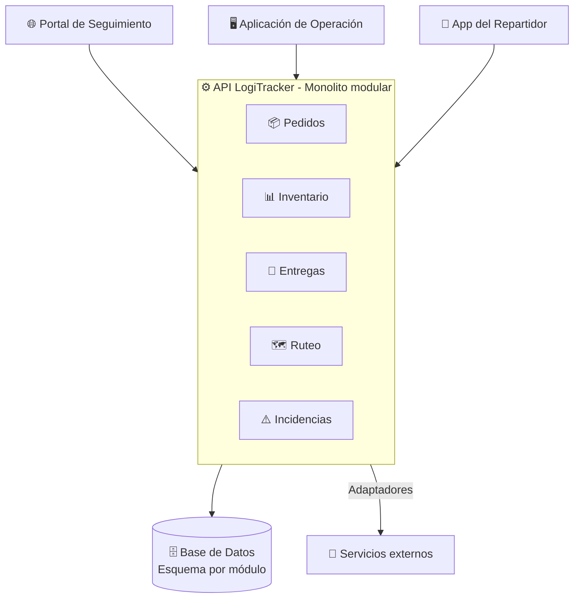

# Arquitectura de LogiTracker

Punto de entrada para entender **qué hace el sistema, cómo está organizado y por qué**. Este documento resume y enlaza; el detalle vive en los documentos de cada actividad y en los ADR.

## 1. Propósito y alcance

LogiTracker centraliza el ciclo de vida de una entrega de última milla, desde el pedido hasta la entrega final, para que exista **una única fuente de verdad** sobre el estado de cada pedido. Resuelve la falta de trazabilidad, los pedidos duplicados y las inconsistencias de inventario descritas en el [análisis del problema](docs/actividad-1/analisis-problema.md).

El alcance, dentro y fuera del sistema, está en el [README](README.md#alcance-del-proyecto).

## 2. Actores y casos principales

| Actor | Casos principales |
| :--- | :--- |
| Cliente | Consultar el estado de su pedido |
| Operador | Registrar pedidos, **asignar repartidores** |
| Administrador de almacén | Confirmar preparación y stock |
| Repartidor | Recibir asignaciones, reportar el estado de la entrega |
| Soporte al cliente | Consultar historial, gestionar incidencias |

Sistemas externos: Pagos, Geolocalización, Notificaciones, ERP/CRM y canales de venta. Ver el [diagrama de contexto C4](docs/actividad-3/c4.md#nivel-1-contexto).

## 3. Vista general

LogiTracker es un **monolito modular** ([ADR-001](docs/adr/ADR-001-estructura-monolito-modular.md)): un solo backend desplegable, dividido en módulos por área de negocio que se comunican solo mediante contratos.

Diagramas completos: [C4 niveles 1, 2 y 3](docs/actividad-3/c4.md).

## 4. Módulos y responsabilidades

| Módulo | Responsabilidad | Dueño de |
| :--- | :--- | :--- |
| **Pedidos** | Registrar y confirmar compras; declarar cuándo un pedido está listo para logística. | Cliente, productos, precio, pago |
| **Inventario** | Mantener el stock y las reservas por almacén. | Existencias y reservas |
| **Entregas** | Asignar repartidores y seguir el estado logístico de cada entrega. | Entrega, asignación, evidencia |
| **Ruteo** | Estimar trayectos y su viabilidad. | Estimaciones de ruta |
| **Incidencias** | Registrar y resolver fallas de la operación. | Incidencias y resoluciones |
| *Auditoría* (transversal) | Registrar quién cambió qué y cuándo. | Registro de cambios |

El significado de cada término dentro de su módulo y los contratos entre módulos están en el [lenguaje ubicuo](docs/actividad-3/lenguaje-ubicuo.md) y el [mapa de contextos](docs/actividad-3/mapa-contextos.md).

## 5. Organización interna de un módulo

Cada módulo sigue **tres capas con puertos y adaptadores** ([ADR-002](docs/adr/ADR-002-diseno-flujo-asignacion.md)):

| Capa | Contiene | Regla |
| :--- | :--- | :--- |
| Dominio | Entidades, objetos de valor, invariantes | No depende de nada. |
| Aplicación | Casos de uso, contratos de entrada y salida, puertos | Solo depende del dominio. |
| Infraestructura | Adaptadores: base de datos, servicios externos, publicación de hechos | Implementa los puertos. |

**Las dependencias apuntan siempre hacia el dominio.** Ver el [diagrama de dependencias](docs/actividad-3/casos-uso-puertos-adaptadores.md#1-capas-y-dirección-de-las-dependencias).

## 6. Flujo principal diseñado: asignar un repartidor

1. El operador elige una entrega pendiente y un repartidor en la Aplicación de Operación.
2. `AssignCourierUseCase` carga la entrega y verifica que no tenga otro repartidor.
3. Consulta la disponibilidad del repartidor por el puerto `ICourierAvailability`.
4. La entidad `Delivery` aplica las invariantes y registra la asignación.
5. Se guarda la entrega, detectando cambios concurrentes.
6. Se publica el hecho *Repartidor asignado* para avisar al repartidor, al cliente y a soporte.

Detalle: [flujo](docs/actividad-3/flujo-asignar-repartidor.md) · [casos de uso, puertos y adaptadores](docs/actividad-3/casos-uso-puertos-adaptadores.md).

## 7. Dónde viven las reglas críticas

| Regla | Ubicación | Comprobación |
| :--- | :--- | :--- |
| Una entrega tiene como máximo un repartidor activo | Entidad `Delivery` | ESC-02, ESC-08 |
| No se asigna a un repartidor fuera de turno o con la ruta saturada | `Delivery` + `CourierAvailability` | ESC-04, ESC-05 |
| Estados coherentes y transiciones permitidas | Entidad `Delivery` | ESC-07, ESC-10 |
| Toda asignación y liberación queda registrada | `CourierAssignment` | ESC-01, ESC-10 |

Lista completa: [invariantes y escenarios](docs/actividad-3/invariantes-y-escenarios.md).

## 8. Seguridad y privacidad

- Entregas **no recibe** precio ni datos de pago: solo dirección, ventana y número de paquetes (contrato C-01).
- Cada actor solo accede a lo que le corresponde. Un cliente no puede consultar pedidos ajenos (escenario de calidad EC-09).
- Toda asignación registra el operador que la hizo (INV-05).
- Este repositorio no contiene claves, contraseñas ni datos personales reales.

## 9. Operación y observabilidad

- Los hechos del dominio se guardan junto con los datos y un proceso en segundo plano los envía (*outbox*), de modo que la falla de un servicio externo no revierte una operación válida.
- Los adaptadores de servicios externos tienen tiempo máximo de espera y reintentos (EC-05).
- Las fallas de integración deben generar alertas (EC-11). Su implementación corresponde a las actividades 4 y 5.

## 10. Decisiones arquitectónicas

| ADR | Decisión | Estado |
| :--- | :--- | :--- |
| [ADR-001](docs/adr/ADR-001-estructura-monolito-modular.md) | Monolito modular por dominios | Aceptada |
| [ADR-002](docs/adr/ADR-002-diseno-flujo-asignacion.md) | Capas con puertos y adaptadores; la Entrega protege la asignación | Aceptada |

## 11. Cómo ejecutar y probar

**Todavía no hay código ejecutable.** Hasta la Actividad 3, el repositorio contiene el análisis y el diseño. La implementación del flujo de asignación, sus pruebas y las instrucciones para ejecutarlo se agregarán en la Actividad 4, siguiendo la [estructura de carpetas propuesta](docs/actividad-3/casos-uso-puertos-adaptadores.md#9-estructura-de-carpetas-propuesta).

## 12. Riesgos y límites conocidos

| Riesgo o límite | Referencia |
| :--- | :--- |
| La aplicación escala completa, no por módulo. | ADR-001 |
| La capacidad del repartidor no está protegida entre entregas asignadas al mismo tiempo. | [ADR-002](docs/adr/ADR-002-diseno-flujo-asignacion.md#riesgos-y-limitaciones-conocidas) |
| Las metas numéricas de calidad son supuestos por validar. | [Escenarios de calidad](docs/actividad-2/escenarios-calidad.md#supuestos-de-medida) |
| Varios términos del negocio están pendientes de confirmar. | [Términos ambiguos](docs/actividad-3/lenguaje-ubicuo.md#2-términos-ambiguos-por-confirmar) |

## 13. Mantenimiento de este documento

Este archivo se actualiza cuando cambia un módulo, un límite, un flujo principal o una decisión arquitectónica. Si una sección describe algo que ya no existe, se corrige o se elimina. Las decisiones nuevas se registran como un ADR y se enlazan en la sección 10.
