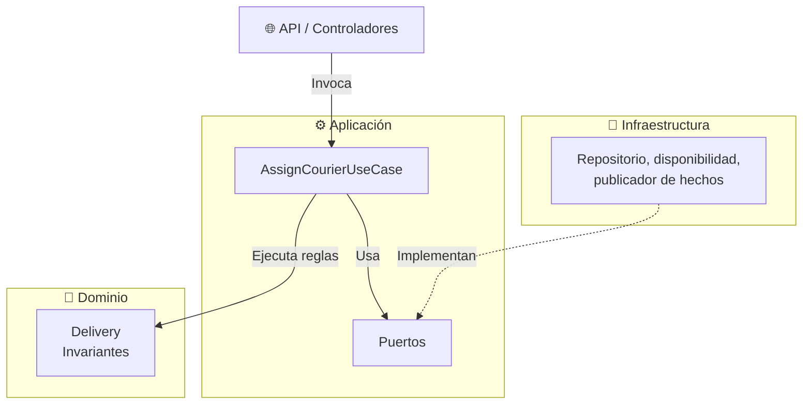

# Plataforma de Gestión Logística de Última Milla (LogiTracker)

## Resumen Ejecutivo

* **Nombre del producto:** LogiTracker - Sistema de Gestión Logística de Última Milla.
* **Problema principal:** Dispersión de información de pedidos entre múltiples canales de venta, inventarios distribuidos y falta de trazabilidad en tiempo real de las entregas. Esto genera retrasos, duplicidad de datos e insatisfacción del cliente.
* **Usuarios principales:** Clientes finales, Operadores de Tienda, Administradores de Almacén, Repartidores y Equipo de Soporte al Cliente.
* **Objetivo del sistema:** Centralizar el ciclo de vida del pedido (desde el registro hasta la entrega final) para garantizar trazabilidad, sincronización de inventario e integración eficiente de rutas.

## Alcance del Proyecto

### Dentro del Alcance
* Recepción e ingesta centralizada de pedidos desde canales externos.
* Módulo de validación y consulta de disponibilidad de inventario distribuido.
* Módulo de asignación y seguimiento de rutas para repartidores.
* Panel de visibilidad de estado en tiempo real para clientes y soporte.
* Gestión básica de incidencias en la entrega.

### Fuera del Alcance
* Construcción de las tiendas digitales o canales de venta: LogiTracker solo recibe los pedidos que estos generan.
* Procesamiento propio de pagos: el cobro se delega al Sistema de Pagos externo.
* Motor cartográfico propio: rutas y coordenadas se obtienen del Servicio de Geolocalización.
* Infraestructura propia de envío de SMS o correos: se delega al Servicio de Notificaciones.
* Reemplazo del ERP/CRM: facturación, contabilidad y datos maestros de clientes siguen en el sistema interno.

## Requisitos Prioritarios

Los requisitos imprescindibles (*Must*) cubren el flujo central **pedido → stock → asignación → seguimiento**:

| ID | Requisito |
| :--- | :--- |
| RF-01 | Registrar pedidos de múltiples canales sin duplicados |
| RF-02 | Validar stock por almacén antes de confirmar |
| RF-03 | Crear ruta y asignar repartidor |
| RF-04 | Actualizar el estado en cada etapa |
| RF-05 | Seguimiento para cliente y soporte |
| RF-09 | Integrar pagos, geolocalización, notificaciones y ERP/CRM |

Los atributos de calidad decisivos son **consistencia** (sin sobreventas, duplicados ni asignaciones dobles) y **facilidad de evolución** (cambiar una regla o un proveedor sin tocar toda la aplicación). Las metas numéricas son supuestos por validar con el negocio ([escenarios de calidad](docs/actividad-2/escenarios-calidad.md)).

## Decisión Arquitectónica

LogiTracker se construye como un **monolito modular por dominios**: una sola aplicación desplegable con módulos de Pedidos, Inventario, Ruteo, Entregas e Incidencias, comunicados solo mediante contratos, y con la infraestructura detrás de adaptadores.

* Se eligió frente a un monolito por capas (no separa las áreas del negocio) y frente a microservicios (complica la consistencia y multiplica el costo operativo sin evidencia que lo justifique).
* **Trade-off aceptado:** la aplicación escala completa y no por módulo. A cambio, se gana consistencia y simplicidad operativa.
* Ruteo queda detrás de un contrato estable para poder extraerlo como servicio si la evidencia lo exige.

Detalle completo en el [ADR-001](docs/adr/ADR-001-estructura-monolito-modular.md).

## Propuesta de Diseño: Asignar un Repartidor

El primer flujo diseñado es **asignar un repartidor a una entrega** (`AssignCourierUseCase`), dentro del módulo de Entregas. La propuesta separa el negocio de la infraestructura en tres capas:

* **Dominio:** la entidad `Delivery` protege las reglas críticas: un solo repartidor activo, solo repartidores en turno y sin la ruta saturada, y estados siempre coherentes.
* **Aplicación:** el caso de uso coordina la asignación y depende solo de puertos (`IDeliveryRepository`, `ICourierAvailability`, `IDeliveryEventPublisher`, `IClock`).
* **Infraestructura:** los adaptadores implementan esos puertos (base de datos, fuente de turnos, publicación de avisos) y se construyen en la Actividad 4.

Las dependencias apuntan siempre hacia el dominio. Las decisiones de diseño y sus alternativas están en el [ADR-002](docs/adr/ADR-002-diseno-flujo-asignacion.md), y la vista general del sistema en [ARCHITECTURE.md](ARCHITECTURE.md).

## Documentación por Actividad

### Actividad 1: Diagnóstico y contexto
* [Diagrama de contexto](docs/actividad-1/diagrama-contexto.md)
* [Análisis del problema](docs/actividad-1/analisis-problema.md)
* [Matriz de riesgos](docs/actividad-1/matriz-de-riesgo.md)
* [Supuestos y decisiones iniciales](docs/actividad-1/supuestos-y-decisiones-iniciales.md)

### Actividad 2: Requisitos y decisión estructural
* [Catálogo de requisitos](docs/actividad-2/catalogo-requisitos.md)
* [Matriz de priorización](docs/actividad-2/matriz-priorizacion.md)
* [Escenarios de calidad](docs/actividad-2/escenarios-calidad.md)
* [Comparación de alternativas](docs/actividad-2/comparacion-alternativas.md)
* [Criterios verificables](docs/actividad-2/criterios-verificables.md)

### Actividad 3: Diseño y dominio
* [Flujo: asignar repartidor](docs/actividad-3/flujo-asignar-repartidor.md)
* [Lenguaje ubicuo y términos ambiguos](docs/actividad-3/lenguaje-ubicuo.md)
* [Modelo de dominio, estados y transiciones](docs/actividad-3/modelo-dominio.md)
* [Invariantes y escenarios de aceptación](docs/actividad-3/invariantes-y-escenarios.md)
* [Mapa de contextos y contratos](docs/actividad-3/mapa-contextos.md)
* [Casos de uso, puertos y adaptadores](docs/actividad-3/casos-uso-puertos-adaptadores.md)
* [Diagramas C4](docs/actividad-3/c4.md)

### Arquitectura y Registros de Decisión (ADR)
* [ARCHITECTURE.md](ARCHITECTURE.md): vista general, módulos, reglas críticas y límites
* [ADR-001: Monolito modular por dominios](docs/adr/ADR-001-estructura-monolito-modular.md)
* [ADR-002: Diseño del dominio y de las capas para la asignación](docs/adr/ADR-002-diseno-flujo-asignacion.md)