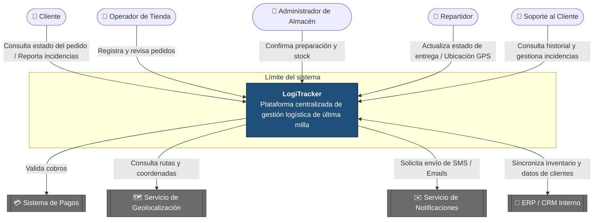

## Diagrama de Contexto

Muestra a LogiTracker como una sola caja, los actores que lo usan, los sistemas externos con los que se integra y la información que cruza el límite del sistema.

**Leyenda**

| Elemento | Significado |
| :--- | :--- |
| 👤 Óvalo | Actor humano que usa el sistema |
| Caja azul | Sistema que se construye (LogiTracker) |
| Caja gris con doble borde | Sistema externo que no se construye, solo se integra |
| Recuadro "Límite del sistema" | Todo lo que está dentro es responsabilidad de LogiTracker |
| Flecha | Dirección de la información o de la solicitud |

> Versión original en imagen: [Diagrama de contextos.png](Diagrama%20de%20contextos.png)
