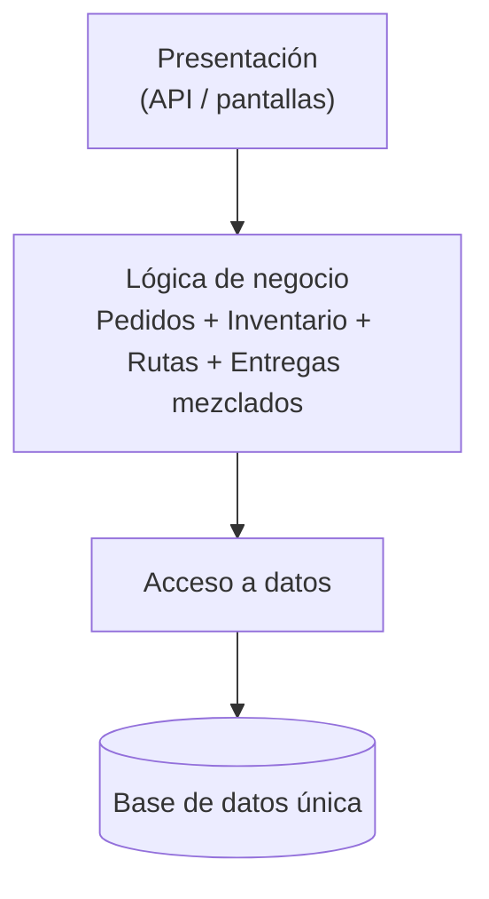
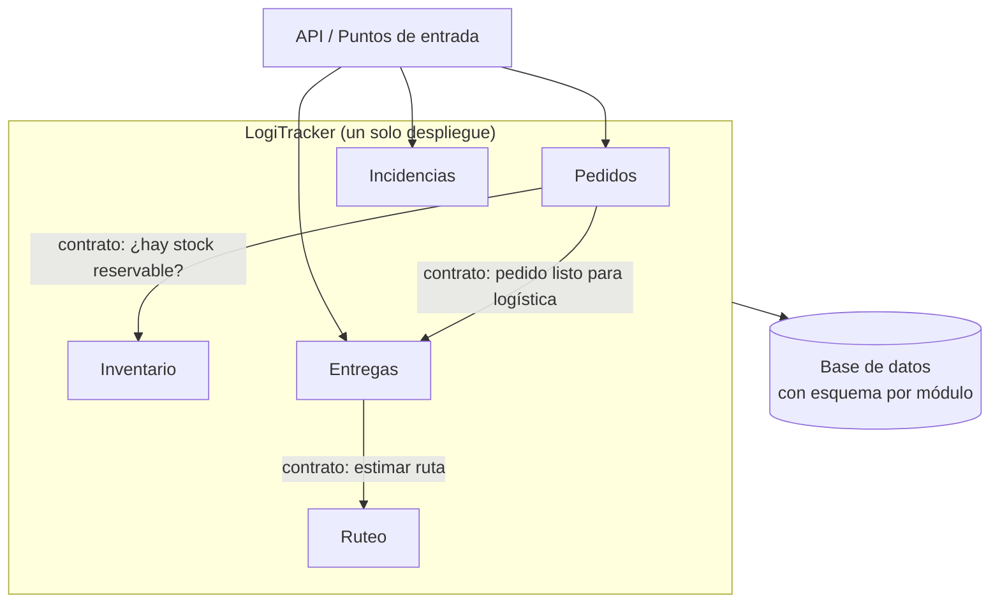
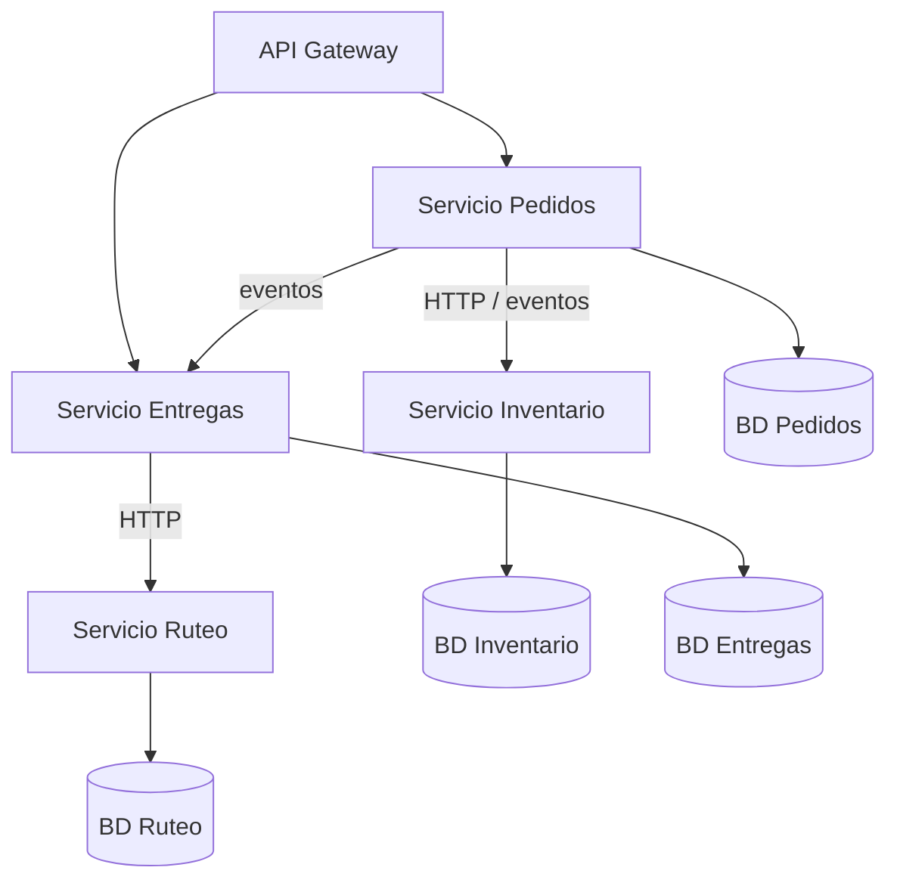

# Comparación de Alternativas Estructurales

Se comparan tres estructuras posibles para LogiTracker según los requisitos priorizados en la [matriz de priorización](matriz-priorizacion.md) y los [escenarios de calidad](escenarios-calidad.md). La pregunta no es cuál es "la mejor arquitectura", sino **cuál es la más apropiada para este caso**, con sus restricciones actuales.

## 1. Alternativas evaluadas

### Alternativa A: Monolito por capas tradicional
Una sola aplicación organizada por capas técnicas (presentación, lógica de negocio, acceso a datos). Las reglas de pedidos, inventario, rutas y entregas conviven en la misma capa de negocio, sin límites entre áreas.

### Alternativa B: Monolito modular por dominios
Una sola aplicación desplegable, dividida internamente en **módulos por área de negocio** (Pedidos, Inventario, Ruteo, Entregas, Incidencias). Cada módulo protege sus reglas y se comunica con los demás solo mediante contratos explícitos. La infraestructura (base de datos, servicios externos) queda detrás de adaptadores.

### Alternativa C: Microservicios por dominio
Cada área de negocio se despliega como un servicio independiente con su propia base de datos. Los servicios se comunican por red (llamadas HTTP y eventos).

> **Nota sobre el enfoque basado en eventos:** no se evalúa como alternativa independiente porque no define cómo se organiza el sistema, sino cómo se comunican sus partes. Puede combinarse con B (eventos internos entre módulos) o con C (eventos entre servicios).

## 2. Evaluación por criterios

Escala de 1 a 5, donde **5 es siempre lo más favorable** para LogiTracker (por ejemplo, en *complejidad*, 5 significa la menor complejidad). Los pesos reflejan la priorización: la alineación con el negocio y la facilidad de evolución pesan más por RES-04 y RES-05.

| Criterio | Peso | A · Capas | B · Monolito modular | C · Microservicios |
| :--- | :---: | :---: | :---: | :---: |
| Alineación con el negocio | 25 % | 2 | **5** | 3 |
| Facilidad de evolución | 20 % | 2 | 4 | 4 |
| Riesgo operativo | 20 % | 4 | 4 | 2 |
| Rapidez de implementación | 15 % | 5 | 4 | 2 |
| Costo | 10 % | 5 | 4 | 1 |
| Complejidad | 10 % | 5 | 4 | 1 |
| **Puntaje ponderado** | 100 % | **3,45** | **4,25** | **2,45** |

### Justificación de cada puntaje

| Criterio | A · Capas | B · Monolito modular | C · Microservicios |
| :--- | :--- | :--- | :--- |
| **Alineación con el negocio** | No refleja las áreas del negocio. "Disponible" o "confirmado" significan cosas distintas para cada área y aquí se mezclan. | Cada módulo corresponde a un área de negocio y protege sus reglas. Cumple RES-05: confiable sin sobrediseño. | Refleja las áreas, pero introduce un costo operativo que el negocio no ha pedido (RES-05). |
| **Facilidad de evolución** | Un cambio en rutas puede romper pedidos (bajo cohesión, alto acoplamiento). Falla EC-07. | Los cambios quedan dentro del módulo responsable (EC-07, EC-08). Un módulo puede extraerse después si lo justifica la evidencia. | Cada servicio evoluciona por separado, pero cambiar un contrato entre servicios exige coordinar versiones y despliegues. |
| **Riesgo operativo** | Un solo despliegue y sin fallas de red. | Igual que A: un solo despliegue y sin fallas de red entre módulos. | Fallas parciales, latencia de red y monitoreo distribuido. Con SC-02 (sin automatización madura), el riesgo es alto. |
| **Rapidez de implementación** | La más rápida al inicio. | Algo más lenta que A, porque hay que definir los contratos entre módulos. | La más lenta: requiere infraestructura, despliegue y comunicación entre servicios desde el día uno. |
| **Costo** | Mínimo. | Bajo: una sola aplicación y una sola base de datos. | Alto: múltiples despliegues, bases de datos y herramientas de observabilidad. |
| **Complejidad** | Baja. | Baja-media: la disciplina de límites se mantiene con revisiones y pruebas de arquitectura. | Alta: consistencia entre servicios, versionado de contratos y transacciones distribuidas. |

## 3. Evaluación frente a los escenarios decisivos

| Escenario | A · Capas | B · Monolito modular | C · Microservicios |
| :--- | :--- | :--- | :--- |
| **EC-03 / EC-04 Consistencia** (prioridad 1) | Se cumple: transacción local. | Se cumple: la reserva de stock y la confirmación ocurren en el mismo proceso. | Difícil: reservar stock en otro servicio requiere coordinación distribuida (sagas, compensaciones); riesgo de sobreventa temporal. |
| **EC-07 / EC-08 Evolución** (prioridad 2) | No se cumple: los cambios se propagan entre áreas. | Se cumple: cambio aislado en el módulo o adaptador responsable. | Se cumple. |
| **EC-05 Resiliencia ante externos** | Posible, pero sin un lugar claro para aislar las integraciones. | Se cumple: adaptadores con tiempo máximo de espera y reintentos. | Se cumple, con mayor costo. |
| **EC-02 Escalabilidad** | Escala la aplicación completa. | Escala la aplicación completa; Ruteo puede extraerse si se convierte en cuello de botella. | Escala cada servicio por separado. |

## 4. Resultado

**La alternativa B (monolito modular por dominios) obtiene el mayor puntaje (4,25)** y es la única que cumple a la vez los dos atributos de mayor prioridad: consistencia y facilidad de evolución.

- **A** es más barata y rápida al inicio, pero no resuelve el problema principal de la Actividad 1: sin límites entre áreas, el sistema repetiría el desorden actual, solo que en un único lugar.
- **C** resuelve muy bien la escalabilidad independiente, pero ese beneficio no compensa su costo hoy: el crecimiento no es uniforme (RES-02), no hay evidencia de que un área necesite desplegarse por separado, y complica la consistencia, que es el atributo más importante.

La decisión y sus trade-offs quedan registrados en el [ADR-001](../adr/ADR-001-estructura-monolito-modular.md).
