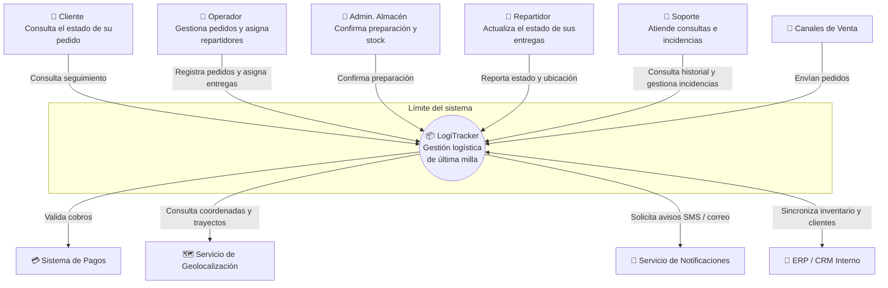
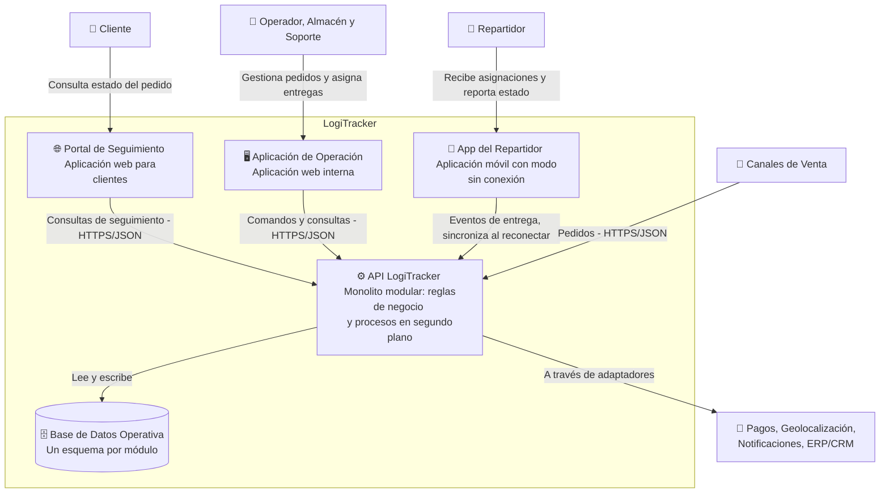
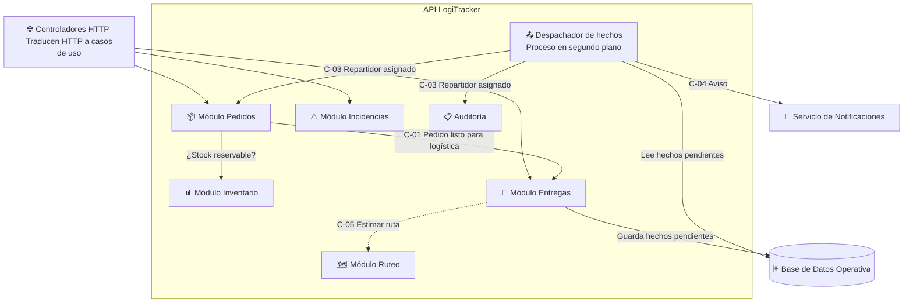
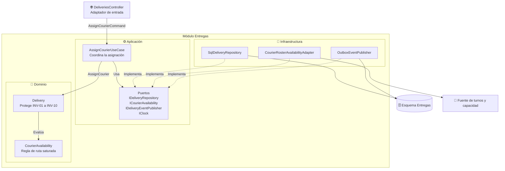

# Diagramas C4

El modelo C4 describe el sistema con distintos niveles de acercamiento. Cada nivel responde una pregunta diferente. Se incluyen los tres niveles útiles para esta actividad; el nivel 4 (código) se omite porque los [fragmentos C#](casos-uso-puertos-adaptadores.md) ya lo describen con más precisión que un diagrama.

| Nivel | Pregunta que responde | Diagrama |
| :--- | :--- | :--- |
| 1 · Contexto | ¿Quién usa LogiTracker y con qué sistemas se conecta? | [Ir](#nivel-1-contexto) |
| 2 · Contenedores | ¿Qué aplicaciones y almacenes de datos forman el sistema? | [Ir](#nivel-2-contenedores) |
| 3 · Componentes | ¿Qué módulos hay dentro de la API y cómo se organiza Entregas? | [Ir](#nivel-3-componentes) |

> En C4, un **contenedor** es una unidad que se ejecuta o almacena datos (una aplicación web, una API, una base de datos). No significa un contenedor Docker. La tecnología concreta de cada contenedor se decide en la Actividad 4.

## Nivel 1: Contexto

Actualiza el [diagrama de contexto de la Actividad 1](../actividad-1/diagrama-contexto.md) con dos cambios: los **canales de venta** aparecen como sistema externo (envían los pedidos), y se separan con claridad los sistemas que LogiTracker **usa** de los actores que lo **usan**.

## Nivel 2: Contenedores

Muestra las aplicaciones que forman LogiTracker. Hay **un solo contenedor de backend**, coherente con la decisión de monolito modular del [ADR-001](../adr/ADR-001-estructura-monolito-modular.md).

| Contenedor | Responsabilidad |
| :--- | :--- |
| **Portal de Seguimiento** | Muestra al cliente el último estado conocido de su pedido. No contiene reglas de negocio. |
| **Aplicación de Operación** | Permite registrar pedidos, asignar repartidores y gestionar incidencias. Aquí el operador inicia el flujo de asignación. |
| **App del Repartidor** | Muestra las entregas asignadas y registra eventos, incluso sin conexión (RF-11). |
| **API LogiTracker** | Contiene todos los módulos de negocio y los procesos en segundo plano (por ejemplo, el envío de hechos pendientes). Es el único contenedor con reglas de negocio. |
| **Base de Datos Operativa** | Guarda los datos de cada módulo en un esquema propio. Ningún módulo lee el esquema de otro. |

## Nivel 3: Componentes

### 3.1 Módulos dentro de la API

### 3.2 Componentes del módulo Entregas (flujo de asignación)

**Cómo leerlo:** las flechas continuas son llamadas, las punteadas son "implementa". Ninguna flecha sale del Dominio, y la Aplicación no apunta a la Infraestructura: los adaptadores apuntan hacia los puertos.
