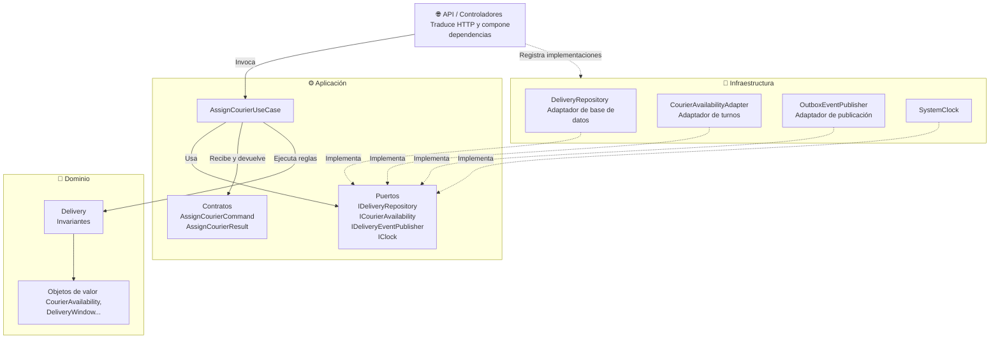
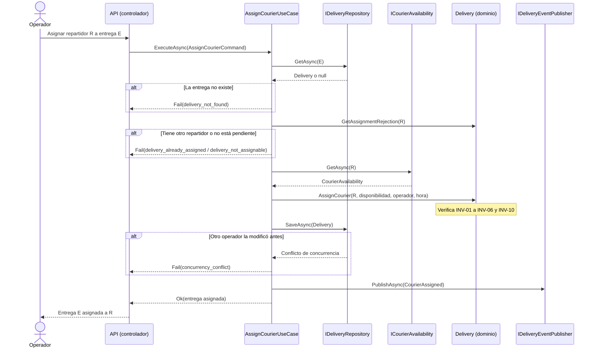

# Casos de Uso, Contratos, Puertos y Adaptadores

Este documento muestra **cómo se separa el negocio de la infraestructura** en el flujo de asignación. Los fragmentos en C# ilustran el diseño, siguiendo el lenguaje del material del curso. **No son una implementación**: el código ejecutable, la persistencia y las integraciones reales corresponden a la Actividad 4.

## 1. Capas y dirección de las dependencias

Se usan **tres capas**, más un punto de entrada que las conecta:

| Capa | Contiene | Depende de | **No** puede depender de |
| :--- | :--- | :--- | :--- |
| **Dominio** | Entidades, objetos de valor, invariantes y hechos del dominio | Nada | Aplicación, infraestructura, bases de datos, HTTP, frameworks |
| **Aplicación** | Casos de uso, contratos de entrada y salida (DTOs) y **puertos** | Dominio | Infraestructura |
| **Infraestructura** | **Adaptadores**: repositorios, clientes de servicios externos, publicadores | Aplicación y Dominio | — |
| *Punto de entrada (API)* | Controladores HTTP y composición de dependencias | Todas | — (es el único lugar que conoce a todos) |

**Regla:** las dependencias apuntan siempre **hacia el dominio**. El dominio y la aplicación definen *qué necesitan* (puertos); la infraestructura decide *cómo se obtiene* (adaptadores).



**Cómo leerlo:** ninguna flecha sale del Dominio, y ninguna flecha va de Aplicación a Infraestructura. Los adaptadores apuntan hacia los puertos (los *implementan*); los puertos no conocen a los adaptadores. Esa es la **inversión de dependencias**.

## 2. Casos de uso del contexto de Entregas

| Caso de uso | Intención | Actor | Alcance en esta actividad |
| :--- | :--- | :--- | :--- |
| **AssignCourierUseCase** | Asignar un repartidor a una entrega pendiente. | Operador | **Diseñado en detalle** |
| **ReleaseCourierUseCase** | Quitar el repartidor de una entrega asignada, con motivo. | Operador | Contrato definido |
| **CreateDeliveryFromOrderUseCase** | Crear una entrega cuando Pedidos publica *Pedido listo para logística* (C-01). | Sistema | Contrato definido |
| **GetDeliveryStatusQuery** | Consultar el estado y el repartidor actual de una entrega. | Soporte, Cliente | Contrato definido |

Cada caso de uso tiene una sola intención, recibe sus dependencias por constructor, depende solo de interfaces y no conoce HTTP, SQL ni proveedores concretos.

## 3. AssignCourierUseCase en detalle

### Pasos (según el enunciado de la actividad)

| Paso | Qué hace | Quién lo hace |
| :---: | :--- | :--- |
| 1 | Cargar la entrega. | Puerto `IDeliveryRepository` |
| 2 | Verificar que exista y que no tenga otro repartidor activo. | Caso de uso, preguntando a `Delivery` |
| 3 | Consultar la disponibilidad del repartidor. | Puerto `ICourierAvailability` (no una API concreta) |
| 4 | Ejecutar `delivery.AssignCourier(...)` para proteger las invariantes. | Dominio: `Delivery` |
| 5 | Guardar la entrega, detectando cambios concurrentes. | Puerto `IDeliveryRepository` |
| 6 | Publicar el resultado (*Repartidor asignado*). | Puerto `IDeliveryEventPublisher` |

### Secuencia



## 4. Contratos de aplicación

### Entrada y salida

```csharp
// Lo que el caso de uso recibe: datos simples, sin tipos de HTTP ni de base de datos.
public sealed record AssignCourierCommand(Guid DeliveryId, Guid CourierId, Guid OperatorId);

// Lo que devuelve: éxito con los datos de la asignación, o un código de error del catálogo.
public sealed record AssignCourierResult(
    bool Succeeded,
    string? ErrorCode,
    Guid DeliveryId,
    Guid? CourierId,
    string? Status,
    DateTimeOffset? AssignedAt)
{
    public static AssignCourierResult Ok(Delivery delivery) => new(
        true, null, delivery.Id.Value,
        delivery.ActiveAssignment!.CourierId.Value,
        delivery.Status.ToString(),
        delivery.ActiveAssignment.AssignedAt);

    public static AssignCourierResult Fail(Guid deliveryId, string errorCode) =>
        new(false, errorCode, deliveryId, null, null, null);
}
```

### Catálogo de errores

Cada error tiene un significado de negocio. El punto de entrada (API) decide cómo traducirlo a HTTP en la Actividad 4.

| Código | Significado | Invariante o causa | Escenario |
| :--- | :--- | :--- | :--- |
| `delivery_not_found` | La entrega no existe. | — | ESC-06 |
| `delivery_already_assigned` | La entrega ya tiene otro repartidor activo. | INV-01 | ESC-02 |
| `delivery_not_assignable` | El estado de la entrega no admite asignación. | INV-02, INV-09 | ESC-07 |
| `courier_not_found` | El repartidor no está registrado. | — | — |
| `courier_unavailable` | El repartidor no está en turno. | INV-03 | ESC-04 |
| `courier_capacity_reached` | El repartidor alcanzó su capacidad ("ruta saturada"). | INV-04 | ESC-05 |
| `concurrency_conflict` | Otro operador modificó la entrega al mismo tiempo. | INV-01 | ESC-08 |
| `availability_service_unavailable` | No se pudo consultar la disponibilidad. Error temporal. | — | ESC-09 |

## 5. Puertos

Los puertos están **en la capa de aplicación** y se expresan en el lenguaje del negocio, no en el de la tecnología.

```csharp
// Puerto de persistencia de entregas.
public interface IDeliveryRepository
{
    Task<Delivery?> GetAsync(DeliveryId id, CancellationToken ct);

    // Guarda la entrega solo si nadie la modificó desde que se leyó.
    // Si cambió, lanza ConcurrencyConflictException (protege INV-01 entre operadores).
    Task SaveAsync(Delivery delivery, CancellationToken ct);
}

// Puerto de consulta de disponibilidad. Entregas define qué necesita saber;
// la fuente real (agenda interna, app del repartidor o proveedor externo) queda en infraestructura.
public interface ICourierAvailability
{
    // Devuelve null si el repartidor no existe.
    // Lanza AvailabilityUnavailableException si la fuente no responde.
    Task<CourierAvailability?> GetAsync(CourierId courierId, CancellationToken ct);
}

// Puerto de publicación de hechos del dominio (notificaciones, Pedidos, auditoría).
public interface IDeliveryEventPublisher
{
    Task PublishAsync(IReadOnlyCollection<IDomainEvent> events, CancellationToken ct);
}

// Puerto de tiempo: permite probar las reglas con una hora controlada.
public interface IClock
{
    DateTimeOffset UtcNow { get; }
}
```

| Puerto | Necesidad que expresa | Por qué es un puerto y no una llamada directa |
| :--- | :--- | :--- |
| `IDeliveryRepository` | Obtener y guardar entregas | La base de datos se elige en la Actividad 4; las reglas no deben depender de ella. |
| `ICourierAvailability` | Saber si un repartidor puede recibir entregas | La fuente real no está definida (C-02). Cambiarla solo cambia el adaptador. |
| `IDeliveryEventPublisher` | Avisar lo que ocurrió | Notificaciones es un servicio externo que puede fallar; la asignación no debe depender de él. |
| `IClock` | Saber la hora actual | Las pruebas pueden fijar la hora y comprobar que la asignación la registra (INV-05). |

> **Segregación de interfaces (la "I" de SOLID):** se prefieren puertos pequeños y específicos. El caso de uso no depende de un "servicio de repartidores" con decenas de métodos, solo de la consulta que necesita.

## 6. El caso de uso

```csharp
public sealed class AssignCourierUseCase
{
    private readonly IDeliveryRepository _deliveries;
    private readonly ICourierAvailability _availability;
    private readonly IDeliveryEventPublisher _publisher;
    private readonly IClock _clock;

    // Todas las dependencias llegan por constructor y son interfaces.
    public AssignCourierUseCase(
        IDeliveryRepository deliveries,
        ICourierAvailability availability,
        IDeliveryEventPublisher publisher,
        IClock clock)
    {
        _deliveries = deliveries;
        _availability = availability;
        _publisher = publisher;
        _clock = clock;
    }

    public async Task<AssignCourierResult> ExecuteAsync(AssignCourierCommand command, CancellationToken ct)
    {
        var deliveryId = new DeliveryId(command.DeliveryId);
        var courierId = new CourierId(command.CourierId);

        // 1. Cargar la entrega
        var delivery = await _deliveries.GetAsync(deliveryId, ct);

        // 2. Verificar que exista y que no tenga otro repartidor activo
        if (delivery is null)
            return AssignCourierResult.Fail(command.DeliveryId, "delivery_not_found");

        var rejection = delivery.GetAssignmentRejection(courierId);
        if (rejection is not null)
            return AssignCourierResult.Fail(command.DeliveryId, rejection);

        try
        {
            // 3. Consultar la disponibilidad mediante un puerto
            var availability = await _availability.GetAsync(courierId, ct);
            if (availability is null)
                return AssignCourierResult.Fail(command.DeliveryId, "courier_not_found");

            // 4. El dominio protege las invariantes
            delivery.AssignCourier(courierId, availability, new OperatorId(command.OperatorId), _clock.UtcNow);

            // 5. Guardar
            await _deliveries.SaveAsync(delivery, ct);
        }
        catch (DomainRuleViolation violation)
        {
            return AssignCourierResult.Fail(command.DeliveryId, violation.Code);
        }
        catch (ConcurrencyConflictException)
        {
            return AssignCourierResult.Fail(command.DeliveryId, "concurrency_conflict");
        }
        catch (AvailabilityUnavailableException)
        {
            return AssignCourierResult.Fail(command.DeliveryId, "availability_service_unavailable");
        }

        // 6. Publicar el resultado
        await _publisher.PublishAsync(delivery.PullEvents(), ct);

        return AssignCourierResult.Ok(delivery);
    }
}
```

**Lo que el caso de uso no hace:** no decide si el repartidor tiene capacidad, no cambia el estado directamente y no construye ningún `HttpClient` ni `SqlConnection`. Solo coordina.

## 7. El dominio que protege las invariantes

```csharp
public sealed class Delivery
{
    private readonly List<CourierAssignment> _history = [];
    private readonly List<IDomainEvent> _events = [];

    public DeliveryId Id { get; }
    public OrderId OrderId { get; }
    public DeliveryAddress Address { get; }
    public DeliveryWindow Window { get; }
    public DeliveryStatus Status { get; private set; } = DeliveryStatus.PendingAssignment;
    public CourierAssignment? ActiveAssignment { get; private set; }
    public IReadOnlyList<CourierAssignment> History => _history;

    public Delivery(DeliveryId id, OrderId orderId, DeliveryAddress address, DeliveryWindow window)
    {
        Id = id;
        OrderId = orderId;
        Address = address;
        Window = window;
    }

    // Responde por qué no se puede asignar este repartidor, o null si se puede.
    // La usa el caso de uso para no consultar la disponibilidad en vano (paso 2).
    public string? GetAssignmentRejection(CourierId courierId)
    {
        if (Status == DeliveryStatus.Assigned && ActiveAssignment!.CourierId == courierId)
            return null;                                   // Reintento idempotente (INV-10)
        if (Status == DeliveryStatus.Assigned)
            return "delivery_already_assigned";            // INV-01
        if (Status != DeliveryStatus.PendingAssignment)
            return "delivery_not_assignable";              // INV-02, INV-09
        return null;
    }

    public void AssignCourier(
        CourierId courierId, CourierAvailability availability, OperatorId assignedBy, DateTimeOffset now)
    {
        var rejection = GetAssignmentRejection(courierId);
        if (rejection is not null)
            throw new DomainRuleViolation(rejection);

        if (Status == DeliveryStatus.Assigned)
            return;                                        // Mismo repartidor: no se duplica (INV-10)

        if (!availability.IsOnShift)
            throw new DomainRuleViolation("courier_unavailable");       // INV-03
        if (availability.IsAtCapacity)
            throw new DomainRuleViolation("courier_capacity_reached");  // INV-04

        ActiveAssignment = new CourierAssignment(courierId, assignedBy, now);  // INV-05
        _history.Add(ActiveAssignment);
        Status = DeliveryStatus.Assigned;                                    // INV-06
        _events.Add(new CourierAssigned(Id, OrderId, courierId, now));
    }

    public void ReleaseCourier(ReleaseReason reason, OperatorId releasedBy, DateTimeOffset now)
    {
        if (Status != DeliveryStatus.Assigned)
            throw new DomainRuleViolation("delivery_not_releasable");   // INV-09

        var released = ActiveAssignment!.Release(reason, releasedBy, now);  // INV-07
        _history[^1] = released;
        ActiveAssignment = null;
        Status = DeliveryStatus.PendingAssignment;                           // INV-06
        _events.Add(new CourierReleased(Id, OrderId, released.CourierId, reason, now));
    }

    public IReadOnlyCollection<IDomainEvent> PullEvents()
    {
        var events = _events.ToArray();
        _events.Clear();
        return events;
    }
}

// La regla de "ruta saturada" vive en un solo lugar. Si el negocio cambia el criterio
// (por ejemplo, a peso o volumen, término T-02), solo cambia este objeto (escenario EC-07).
public sealed record CourierAvailability(bool IsOnShift, int AssignedDeliveries, int MaxDeliveries)
{
    public bool IsAtCapacity => AssignedDeliveries >= MaxDeliveries;
}
```

> Los objetos de valor restantes (`DeliveryId`, `DeliveryWindow`, `CourierAssignment`, etc.) y sus validaciones están descritos en el [modelo de dominio](modelo-dominio.md#objetos-de-valor). Ninguna clase del dominio usa `using` de bases de datos, HTTP o frameworks.

## 8. Adaptadores propuestos

Los adaptadores se implementan en la Actividad 4. Aquí se define **qué puerto cumple cada uno** y qué alternativa existe para pruebas.

| Puerto | Adaptador de producción (Actividad 4) | Adaptador para pruebas | Responsabilidad del adaptador |
| :--- | :--- | :--- | :--- |
| `IDeliveryRepository` | `SqlDeliveryRepository` | `InMemoryDeliveryRepository` | Traducir la entrega a tablas del esquema de Entregas; usar un número de versión para detectar cambios concurrentes. |
| `ICourierAvailability` | `CourierRosterAvailabilityAdapter` (agenda interna) o `TransportProviderAvailabilityAdapter` (proveedor externo) | `FakeCourierAvailability` | Obtener turno y carga del repartidor y traducirlos a `CourierAvailability`, con tiempo máximo de espera. |
| `IDeliveryEventPublisher` | `OutboxEventPublisher` | `RecordingEventPublisher` | Guardar los hechos junto con la entrega y enviarlos después a Notificaciones, Pedidos y Auditoría (ADR-002, D-06). |
| `IClock` | `SystemClock` | `FixedClock` | Entregar la hora actual. |

**Adaptadores de entrada:** `DeliveriesController` (API HTTP para el operador) traduce la petición a `AssignCourierCommand` y el `AssignCourierResult` a una respuesta HTTP. No contiene reglas de negocio.

## 9. Estructura de carpetas propuesta

Sigue la estructura recomendada por la actividad, con una subcarpeta por módulo dentro de cada capa (decisión D-07 del [ADR-002](../adr/ADR-002-diseno-flujo-asignacion.md)):

```text
/src
  /Domain
    /Deliveries          Delivery, CourierAssignment, CourierAvailability, DeliveryWindow...
  /Application
    /Deliveries
      /AssignCourier     AssignCourierUseCase, AssignCourierCommand, AssignCourierResult
      /Ports             IDeliveryRepository, ICourierAvailability, IDeliveryEventPublisher, IClock
  /Infrastructure
    /Deliveries          SqlDeliveryRepository, CourierRosterAvailabilityAdapter, OutboxEventPublisher
  /Api                   DeliveriesController, composición de dependencias
/tests
  /Domain.Tests          Pruebas de invariantes (escenarios ESC-01 a ESC-12)
  /Application.Tests     Pruebas del caso de uso con adaptadores de prueba
```
