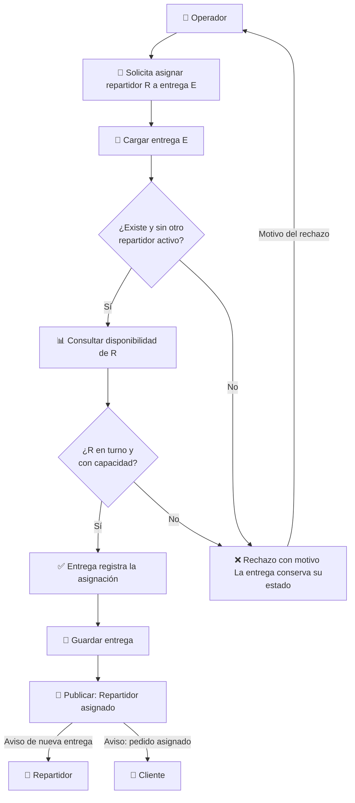

# Flujo de Negocio: Asignar un Repartidor a una Entrega

## 1. Por qué este flujo

Asignar un repartidor es el punto donde un pedido deja de ser una compra y se convierte en un trabajo logístico con un responsable. Es el flujo elegido porque concentra los riesgos y atributos priorizados en las actividades anteriores:

| Motivo | Referencia |
| :--- | :--- |
| Es un requisito imprescindible (*Must*). | RF-03 en la [matriz de priorización](../actividad-2/matriz-priorizacion.md) |
| Exige **consistencia**: una entrega no puede quedar con dos repartidores. | RNF-01, atributo de prioridad 1 |
| Su regla de capacidad cambiará con el negocio: debe poder modificarse sin tocar otros módulos. | Escenario EC-07 |
| Depende de información que no es suya (disponibilidad del repartidor) y avisa a otros (cliente, soporte). | Contratos entre contextos |

## 2. Ficha del flujo

| Elemento | Descripción |
| :--- | :--- |
| **Nombre** | Asignar repartidor a una entrega (`AssignCourierUseCase`) |
| **Contexto responsable** | Entregas ([mapa de contextos](mapa-contextos.md)) |
| **Actor principal** | Operador con permiso de asignación (ver término ambiguo T-07 en el [lenguaje ubicuo](lenguaje-ubicuo.md)) |
| **Actores secundarios** | Repartidor (recibe la asignación), Cliente (recibe el aviso), Soporte (consulta quién lleva la entrega), Servicio de Notificaciones (externo) |
| **Propósito** | Que cada entrega pendiente tenga **un único repartidor responsable**, que esté en turno y que todavía tenga capacidad para llevarla. |
| **Disparador** | El operador elige una entrega pendiente y un repartidor. |
| **Precondiciones** | La entrega existe y fue creada a partir de un pedido listo para logística. El repartidor está registrado. |
| **Resultado esperado** | La entrega queda en estado **Asignada**, con su repartidor, la hora y quién hizo la asignación. Se publica el hecho *Repartidor asignado* para notificar y actualizar el seguimiento. |
| **Resultado si falla** | La entrega **conserva su estado anterior** y el operador recibe un motivo comprensible (por ejemplo, "el repartidor alcanzó su capacidad"). |

## 3. Flujo principal

1. El operador solicita asignar el repartidor **R** a la entrega **E**.
2. El sistema carga la entrega **E**.
3. El sistema verifica que **E** existe y que no tiene otro repartidor activo.
4. El sistema consulta la **disponibilidad** de **R**: si está en turno, cuántas entregas lleva y cuál es su capacidad máxima.
5. La entrega aplica sus reglas y registra la asignación (invariantes INV-01 a INV-06).
6. El sistema guarda la entrega.
7. El sistema publica el hecho *Repartidor asignado*.
8. El operador ve la entrega en estado **Asignada**.

## 4. Flujos alternativos

| ID | Situación | Respuesta del sistema | Escenario |
| :--- | :--- | :--- | :--- |
| FA-01 | La entrega no existe. | Rechaza la solicitud: "entrega no encontrada". | ESC-06 |
| FA-02 | La entrega ya tiene **otro** repartidor activo. | Rechaza la solicitud sin consultar la disponibilidad. | ESC-02 |
| FA-03 | La entrega ya tiene **ese mismo** repartidor (reintento por falla de red). | Responde con éxito sin crear una segunda asignación. | ESC-03 |
| FA-04 | El repartidor no está en turno. | Rechaza: "repartidor no disponible". | ESC-04 |
| FA-05 | El repartidor alcanzó su capacidad máxima ("ruta saturada"). | Rechaza: "capacidad del repartidor alcanzada". | ESC-05 |
| FA-06 | La entrega está en camino, entregada, fallida o cancelada. | Rechaza: "la entrega no admite asignación en su estado actual". | ESC-07 |
| FA-07 | Dos operadores asignan la misma entrega al mismo tiempo. | Solo una asignación se guarda; la otra recibe "conflicto, vuelva a consultar". | ESC-08 |
| FA-08 | El servicio de disponibilidad no responde. | No asigna; la entrega sigue pendiente y se informa un error temporal. | ESC-09 |

## 5. Fuera del alcance de este flujo

Para mantener el flujo acotado, estos temas **no** se diseñan aquí:

- Calcular o optimizar la ruta geográfica del repartidor (responsabilidad de Ruteo).
- Que el repartidor acepte o rechace la asignación desde su aplicación (ver término ambiguo T-08).
- Asignación automática por algoritmo: si existe en el futuro, reutilizará este mismo caso de uso.
- Registrar la entrega con evidencia, entregas fallidas y reintentos: se mencionan en los estados, pero no se detallan.
- Persistencia real e integración real con servicios externos: corresponden a la Actividad 4.

## 6. Recorrido completo

