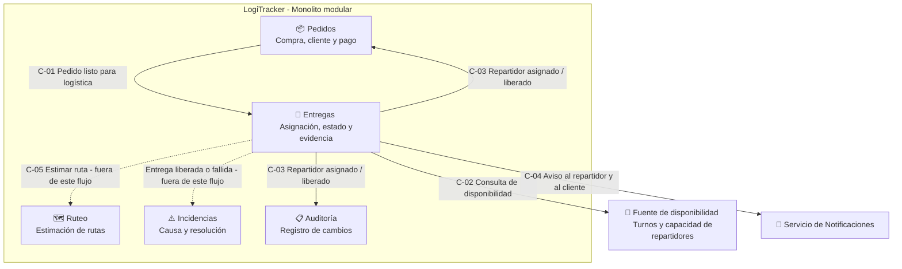

# Mapa de Contextos

Un **contexto delimitado** (*bounded context*) es una frontera dentro de la cual las palabras y las reglas tienen un significado acordado. El **mapa de contextos** muestra esas fronteras y qué información cruza entre ellas.

Los contextos coinciden con los módulos definidos en el [ADR-001](../adr/ADR-001-estructura-monolito-modular.md). **Un contexto no es un microservicio**: todos viven dentro del mismo monolito modular y se comunican por contratos internos.

## 1. Contextos involucrados en el flujo

| Contexto | Pregunta que responde | Dueño de | Papel en el flujo de asignación |
| :--- | :--- | :--- | :--- |
| **Pedidos** | ¿El cliente compró y la compra está aceptada? | Cliente, productos, precio, pago, estado comercial | **Origen**: declara que un pedido está listo para logística. |
| **Entregas** | ¿Quién lleva el paquete y en qué etapa va? | Entrega, asignación, repartidor activo, estado logístico | **Responsable** del flujo y de sus invariantes. |
| **Ruteo** | ¿Qué trayecto es viable y cuánto tarda? | Estimaciones de ruta, distancias, tiempos | **Consumidor posterior**: estima la ruta del repartidor después de asignar. No participa en la decisión. |
| **Incidencias** | ¿Qué falló y cómo se resolvió? | Incidencias, causa, responsable, resolución | **Relacionado**: una liberación o una entrega fallida pueden originar una incidencia. |
| **Transversal: Auditoría** | ¿Quién cambió qué y cuándo? | Registro de cambios | Registra cada asignación y liberación. |

Los servicios externos (Notificaciones, Geolocalización, Pagos, ERP) **no son contextos de LogiTracker**: se integran mediante adaptadores que traducen su modelo al nuestro.

## 2. Mapa

Las flechas continuas son los contratos que usa este flujo. Las punteadas existen en el sistema, pero se diseñan en otras actividades.

## 3. Contratos entre contextos

Para cada contrato se aclara **qué significa** y, sobre todo, **qué no significa**, para evitar que un contexto interprete un dato con las reglas de otro.

### C-01 · Pedido listo para logística (Pedidos → Entregas)

**Tipo:** hecho publicado por Pedidos. **Dueño del significado:** Pedidos.

| Dato | Qué significa | Qué **no** significa |
| :--- | :--- | :--- |
| `OrderId` | Identificador de la compra que debe entregarse. | No da acceso a las reglas ni al precio de la compra. |
| `DeliveryAddress` | Lugar al que debe llevarse el paquete. | No garantiza que la dirección tenga una ruta viable. |
| `DeliveryWindow` | Intervalo en que el cliente espera recibirlo. | No es un compromiso de hora exacta. |
| `PackageCount` | Número de paquetes a transportar. | No incluye productos, precios ni descuentos. |

Con este contrato, Entregas crea una **Entrega** en estado *Pendiente de asignación*. Entregas **no recibe** precio, método de pago ni estado del pago: no los necesita para transportar el paquete.

### C-02 · Consulta de disponibilidad del repartidor (Entregas → fuente de disponibilidad)

**Tipo:** consulta mediante el puerto `ICourierAvailability`. **Dueño del significado:** Entregas define qué necesita; la fuente responde.

| Dato | Qué significa | Qué **no** significa |
| :--- | :--- | :--- |
| `IsOnShift` | El repartidor está trabajando en este momento. | No indica que esté cerca de la dirección. |
| `AssignedDeliveries` | Entregas activas que lleva en este momento. | No es el total de entregas del día. |
| `MaxDeliveries` | Capacidad máxima de entregas activas simultáneas. | No es una regla fija: puede variar por repartidor (T-06). |

> **Pendiente de confirmar:** la fuente real de los turnos y la capacidad (una agenda interna, la app del repartidor o un proveedor de transporte externo) no está definida en el caso. Por eso se accede a ella mediante un puerto: cambiar la fuente solo cambia el adaptador.

### C-03 · Repartidor asignado / Repartidor liberado (Entregas → Pedidos, Auditoría)

**Tipo:** hecho publicado por Entregas. **Dueño del significado:** Entregas.

| Dato | Qué significa | Qué **no** significa |
| :--- | :--- | :--- |
| `DeliveryId`, `OrderId` | Qué entrega y qué pedido cambiaron. | — |
| `CourierId` | Quién es ahora responsable del traslado. | No indica que el paquete ya salió. |
| `OccurredAt` | Momento de la asignación o liberación. | — |
| `ReleaseReason` (solo liberación) | Por qué se quitó al repartidor. | No es una incidencia: abrirla es decisión de Incidencias. |

Pedidos usa este hecho para actualizar la vista que consulta soporte. **No cambia** el estado comercial del pedido: "repartidor asignado" no equivale a "pedido completado".

### C-04 · Aviso al repartidor y al cliente (Entregas → Servicio de Notificaciones)

**Tipo:** solicitud a un servicio externo mediante un adaptador. El adaptador traduce el hecho *Repartidor asignado* al formato del proveedor (SMS, correo o push). Si el proveedor falla, **la asignación no se revierte**: el aviso se reintenta (escenario de calidad EC-11).

### C-05 · Estimar ruta (Entregas → Ruteo) · fuera de este flujo

Se documenta para mostrar el límite: después de asignar, Ruteo puede estimar el trayecto del repartidor mediante un contrato estable (`IRouteEstimator`, ADR-001). **La asignación no espera esa estimación**, de modo que si Ruteo está saturado en temporada alta, la asignación sigue funcionando.

## 4. Relaciones entre contextos

| Relación | Tipo | Explicación |
| :--- | :--- | :--- |
| Pedidos → Entregas | **Cliente-proveedor con lenguaje publicado** | Pedidos (proveedor) publica un contrato estable; Entregas (cliente) lo traduce a su propio modelo de Entrega. |
| Entregas → Pedidos | **Hechos publicados** | Entregas informa lo ocurrido; Pedidos decide qué hacer con ello en su propio modelo. |
| Entregas → Servicios externos | **Capa anticorrupción** | Los adaptadores evitan que los formatos de proveedores externos contaminen el modelo de Entregas. |
| Entregas → Ruteo | **Cliente-proveedor** | Entregas consume estimaciones por un contrato que permite extraer Ruteo como servicio más adelante. |

## 5. Qué dato pertenece a qué contexto

| Dato | Contexto dueño | Razón |
| :--- | :--- | :--- |
| Precio y estado del pago | Pedidos | Describe la operación comercial. |
| Dirección de entrega | Pedidos (la captura) → se comparte con Entregas | Entregas la necesita para el traslado, pero no la modifica. |
| Repartidor asignado | Entregas | Describe quién realiza el trabajo logístico. |
| Turno y capacidad del repartidor | Fuente de disponibilidad (se consulta) | Entregas la usa para decidir, pero no la mantiene. |
| Estimación de ruta | Ruteo | Proviene del cálculo de trayectos. |
| Motivo de una liberación | Entregas | Lo registra quien decide liberar. |
