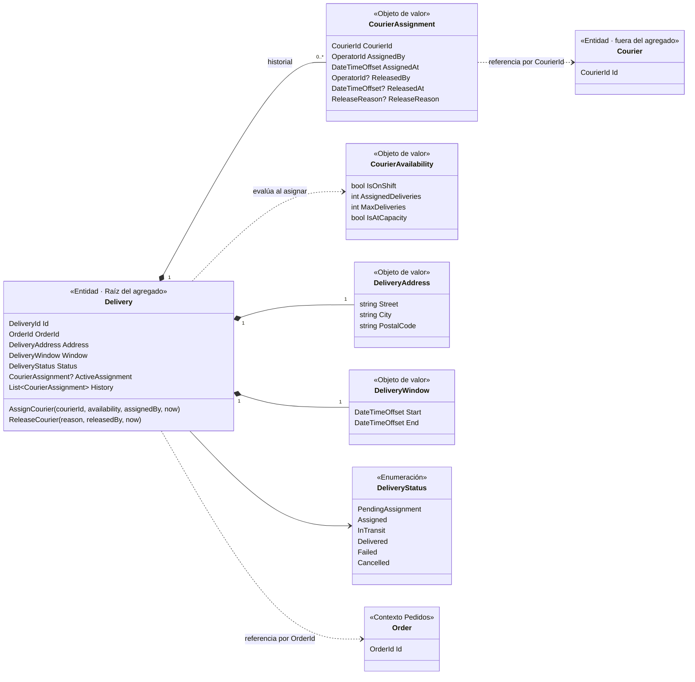
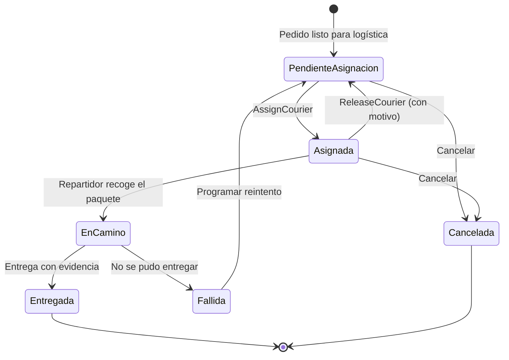

# Modelo de Dominio del Flujo de Asignación

Este modelo representa los conceptos del [lenguaje ubicuo](lenguaje-ubicuo.md) que necesita el flujo [asignar repartidor](flujo-asignar-repartidor.md). Solo incluye lo necesario para el flujo: no es el modelo completo de LogiTracker.

## 1. Entidades y objetos de valor

La diferencia clave: una **entidad** conserva su identidad aunque cambien sus datos (la entrega E-245 sigue siendo E-245 cuando cambia de estado). Un **objeto de valor** se define solo por sus datos: dos direcciones con la misma calle, ciudad y código postal son la misma dirección.

### Entidades

| Entidad | Identidad | Responsabilidad | ¿Por qué es entidad? |
| :--- | :--- | :--- | :--- |
| **Entrega** (`Delivery`) | `DeliveryId` | **Raíz del agregado.** Protege las reglas de asignación y controla las transiciones de estado. Es el único punto por el que se puede asignar o liberar un repartidor. | Cambia de estado y de repartidor durante su vida, pero sigue siendo la misma entrega. |
| **Repartidor** (`Courier`) | `CourierId` | Persona que lleva entregas. **En este flujo no se carga ni se modifica**: la entrega solo guarda su identificador y consulta su disponibilidad. | Tiene identidad propia y una vida más larga que cualquier entrega. |

> **Agregado:** grupo de objetos que se guarda y se modifica como una unidad, con una raíz que protege sus reglas. Aquí el agregado es la **Entrega** junto con sus asignaciones. El repartidor está **fuera** del agregado: la entrega solo lo referencia por su identificador.

### Objetos de valor

| Objeto de valor | Atributos | Regla que valida al crearse |
| :--- | :--- | :--- |
| `DeliveryId` | `Guid Value` | No puede ser vacío. |
| `CourierId` | `Guid Value` | No puede ser vacío. |
| `OrderId` | `Guid Value` | No puede ser vacío. Referencia al pedido del contexto de Pedidos. |
| `OperatorId` | `Guid Value` | No puede ser vacío. |
| `DeliveryAddress` | `Street`, `City`, `PostalCode` | Los tres campos son obligatorios. |
| `DeliveryWindow` | `Start`, `End` | `Start` es anterior a `End` (INV-08). |
| `CourierAssignment` | `CourierId`, `AssignedBy`, `AssignedAt`, `ReleasedBy?`, `ReleasedAt?`, `ReleaseReason?` | Si fue liberada, debe tener quién la liberó, cuándo y el motivo (INV-07). Liberarla crea una copia nueva, no modifica la original. |
| `CourierAvailability` | `IsOnShift`, `AssignedDeliveries`, `MaxDeliveries` | `MaxDeliveries` es mayor que 0 y `AssignedDeliveries` no es negativo. Expone `IsAtCapacity`. |
| `ReleaseReason` | `string Value` | No puede estar vacío. |
| `DeliveryStatus` | Uno de: `PendingAssignment`, `Assigned`, `InTransit`, `Delivered`, `Failed`, `Cancelled` | Solo cambia mediante las transiciones permitidas. |

## 2. Mapa de entidades y relaciones

**Cómo leerlo:** el rombo negro (`*--`) indica que el objeto forma parte de la entrega y se guarda con ella. La línea punteada (`..>`) indica que solo se usa o se referencia por identificador, sin cargar el objeto completo.

## 3. Estados y transiciones de la Entrega

### Tabla de transiciones

Las transiciones **en negrita** son las que diseña esta actividad. Las demás se incluyen para mostrar el ciclo completo y se detallan en actividades posteriores.

| Estado actual | Acción | Nuevo estado | Condición |
| :--- | :--- | :--- | :--- |
| — | Pedido listo para logística | Pendiente de asignación | Llega el contrato de Pedidos con dirección y ventana válidas. |
| **Pendiente de asignación** | **Asignar repartidor** | **Asignada** | Repartidor en turno y sin capacidad alcanzada (INV-03, INV-04). |
| **Asignada** | **Asignar el mismo repartidor** | **Asignada (sin cambios)** | Reintento idempotente (INV-10). |
| **Asignada** | **Liberar repartidor** | **Pendiente de asignación** | Motivo obligatorio (INV-07). |
| Asignada | Repartidor recoge el paquete | En camino | — |
| En camino | Entrega con evidencia | Entregada | Requiere evidencia de recepción. |
| En camino | No se pudo entregar | Fallida | Requiere causa. |
| Fallida | Programar reintento | Pendiente de asignación | Supuesto por confirmar con operación. |
| Pendiente o Asignada | Cancelar | Cancelada | — |

### Transiciones prohibidas (relevantes para este flujo)

| Transición | Por qué se prohíbe | Invariante |
| :--- | :--- | :--- |
| Asignada → Asignada con **otro** repartidor | Habría dos responsables o se perdería quién era el anterior. Primero hay que liberar. | INV-01 |
| En camino, Entregada, Fallida o Cancelada → Asignada | El paquete ya salió o la entrega terminó. | INV-02, INV-09 |
| En camino → Pendiente de asignación | No se libera a un repartidor que lleva el paquete. Ese caso es una incidencia. | INV-09 |

## 4. Dónde vive cada regla

| Regla | Dónde vive | Por qué ahí |
| :--- | :--- | :--- |
| Un solo repartidor activo, transiciones de estado válidas | `Delivery` | Es la raíz del agregado: nadie puede cambiar su estado sin pasar por sus métodos. |
| "Ruta saturada" (capacidad alcanzada) | `CourierAvailability.IsAtCapacity` | La regla cambia con el negocio (T-02). Si cambia el criterio, se modifica solo este objeto de valor (EC-07). |
| Ventana de entrega válida, dirección completa | `DeliveryWindow`, `DeliveryAddress` | Un objeto de valor inválido no puede existir. |
| Que la entrega exista, consultar la disponibilidad | `AssignCourierUseCase` (aplicación) | Es coordinación, no regla de negocio: requiere hablar con puertos. |

El detalle de cada invariante y sus escenarios de comprobación está en [invariantes-y-escenarios.md](invariantes-y-escenarios.md).
