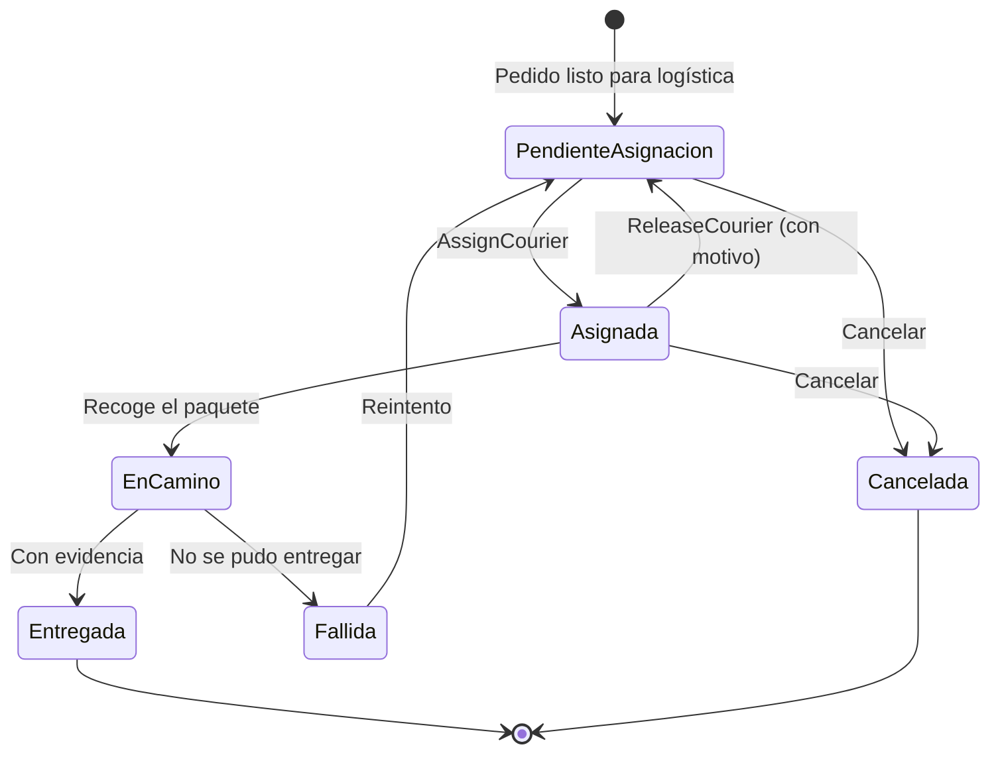
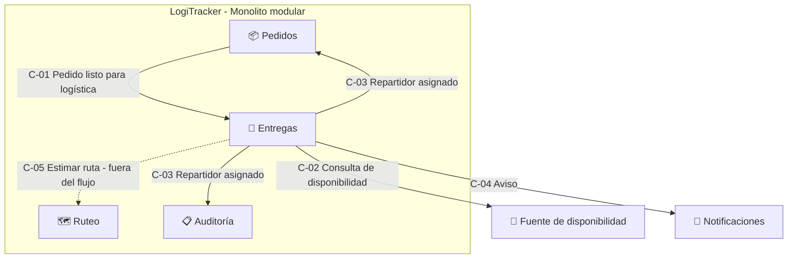
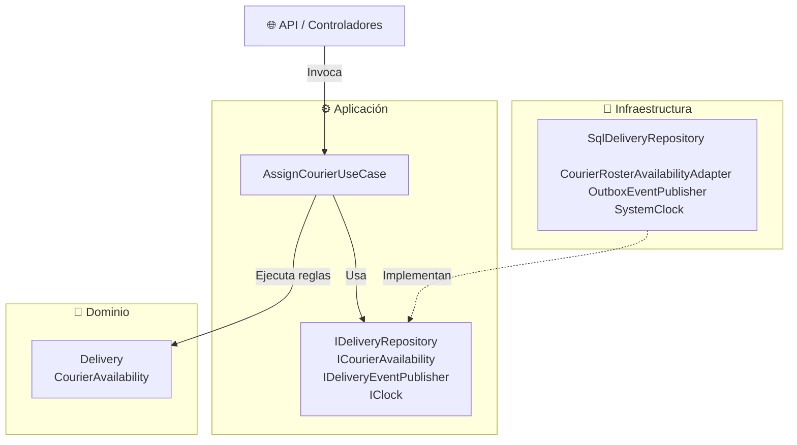

# Actividad 3: Diseño y dominio

Vista condensada de todo lo diseñado en la actividad. Cada sección enlaza al documento con el detalle.

---

## 1. El flujo elegido: asignar un repartidor a una entrega

[Detalle](flujo-asignar-repartidor.md)

| | |
| :--- | :--- |
| **Caso de uso** | `AssignCourierUseCase` |
| **Contexto** | Entregas |
| **Actor principal** | Operador con permiso de asignación |
| **Actores secundarios** | Repartidor, Cliente, Soporte, Servicio de Notificaciones |
| **Propósito** | Que cada entrega pendiente tenga un único repartidor responsable, en turno y con capacidad. |
| **Resultado** | La entrega queda *Asignada* con repartidor, hora y operador; se publica *Repartidor asignado*. |
| **Si falla** | La entrega conserva su estado y se informa el motivo. |

**Por qué este flujo:** es requisito *Must* (RF-03), exige consistencia (prioridad 1 de la Actividad 2), su regla de capacidad va a cambiar (EC-07) y depende de información que no es suya.

**Fuera del flujo:** cálculo de ruta geográfica, aceptación por el repartidor, asignación automática, entrega con evidencia, persistencia e integraciones reales (Actividad 4).

---

## 2. Lenguaje ubicuo

[Detalle](lenguaje-ubicuo.md)

| Término | Código | Significado |
| :--- | :--- | :--- |
| Entrega | `Delivery` | Trabajo de llevar los paquetes de un pedido. **No es el pedido** (pedido = compra). |
| Repartidor | `Courier` | Quien transporta. Aquí solo importa su identidad, turno y capacidad. |
| Asignación | `CourierAssignment` | Quién es responsable, cuándo y quién lo decidió. |
| Repartidor activo | `ActiveAssignment` | El de la asignación vigente. Máximo uno. |
| Disponibilidad | `CourierAvailability` | En turno + entregas que lleva + capacidad máxima. |
| Ruta saturada | `IsAtCapacity` | Lleva tantas entregas como su capacidad máxima. |
| Liberar | `ReleaseCourier` | Quitar al repartidor con motivo obligatorio. |

### Términos ambiguos (supuesto adoptado, pendiente de confirmar)

| ID | Término | Supuesto |
| :--- | :--- | :--- |
| T-01 | Ruta | En Entregas se dice "carga del repartidor"; "ruta" es de Ruteo. |
| T-02 | Ruta saturada | Se mide por número de entregas activas. |
| T-03 | Disponible | En turno y sin capacidad alcanzada (cambia de significado en cada contexto). |
| T-04 | Repartidor activo | El de la asignación vigente, no "el que trabaja hoy". |
| T-05 | Reasignar | Solo desde *Asignada*, liberando primero con motivo. |
| T-06 | Capacidad máxima | Número por repartidor, lo entrega el puerto de disponibilidad. |
| T-07 | Quién asigna | Un operador con permiso. |
| T-08 | Asignada vs. aceptada | La asignación es efectiva sin aceptación. |
| T-09 | Confirmado | No se usa en Entregas, para no confundirlo con Pedidos. |

---

## 3. Modelo de dominio

[Detalle](modelo-dominio.md)

**Entidades** (tienen identidad):

| Entidad | Papel |
| :--- | :--- |
| `Delivery` | **Raíz del agregado.** Única que puede asignar o liberar. Protege las reglas. |
| `Courier` | Fuera del agregado. La entrega solo guarda su `CourierId`. |

**Objetos de valor** (se definen por sus datos): `DeliveryId`, `CourierId`, `OrderId`, `OperatorId`, `DeliveryAddress`, `DeliveryWindow` (inicio < fin), `CourierAssignment`, `CourierAvailability`, `ReleaseReason`, `DeliveryStatus`.

### Estados de la entrega



**Transiciones prohibidas:** asignar otro repartidor a una entrega ya asignada · asignar una entrega en camino, entregada, fallida o cancelada · liberar a un repartidor que va en camino.

---

## 4. Invariantes

[Detalle](invariantes-y-escenarios.md)

| ID | Regla que siempre se cumple |
| :--- | :--- |
| INV-01 | Máximo un repartidor activo por entrega. |
| INV-02 | Solo se asigna a entregas *Pendientes de asignación*. |
| INV-03 | No se asigna a un repartidor fuera de turno. |
| INV-04 | No se asigna si la ruta del repartidor está saturada. |
| INV-05 | Toda asignación registra repartidor, operador y hora. |
| INV-06 | *Asignada* y *En camino* siempre tienen repartidor; *Pendiente* nunca. |
| INV-07 | Liberar exige motivo. |
| INV-08 | La ventana de entrega tiene inicio antes del fin. |
| INV-09 | Una entrega en camino o terminada no cambia de repartidor. |
| INV-10 | Repetir la misma asignación no la duplica. |

### Escenarios Dado-Cuando-Entonces

| ID | Situación | Resultado | Invariante |
| :--- | :--- | :--- | :--- |
| ESC-01 | Ana en turno (3 de 5), entrega pendiente | Asignada, se publica el hecho | INV-05, INV-06 |
| ESC-02 | Entrega ya asignada a Luis, se intenta con Ana | Rechazo, ni se consulta a Ana | INV-01 |
| ESC-03 | Reintento con la misma Ana | Éxito sin duplicar | INV-10 |
| ESC-04 | Ana fuera de turno | Rechazo | INV-03 |
| ESC-05 | Ana con 5 de 5 | Rechazo: capacidad alcanzada | INV-04 |
| ESC-06 | Entrega inexistente | Rechazo | — |
| ESC-07 | Entrega en camino | Rechazo | INV-09 |
| ESC-08 | Dos operadores a la vez | Solo una se guarda | INV-01 |
| ESC-09 | Servicio de disponibilidad caído | No se asigna, error temporal | — |
| ESC-10 | Liberar con motivo | Vuelve a pendiente, historial conserva | INV-07 |
| ESC-11 | Liberar sin motivo | Rechazo | INV-07 |
| ESC-12 | Ventana 18:00 a 14:00 | No se crea la entrega | INV-08 |

Ejemplo:

```gherkin
Escenario: ESC-05 Rechazar la asignación si la ruta del repartidor está saturada
  Dado que la entrega E-245 está "Pendiente de asignación"
  Y que Ana está en turno con 5 entregas activas y capacidad máxima de 5
  Cuando la operadora Marta asigna a Ana a la entrega E-245
  Entonces la asignación es rechazada con el motivo "capacidad del repartidor alcanzada"
  Y la entrega E-245 sigue "Pendiente de asignación"
```

---

## 5. Contextos y contratos

[Detalle](mapa-contextos.md)



| Contrato | Viaja | Lo que **no** significa |
| :--- | :--- | :--- |
| C-01 Pedido listo para logística | `OrderId`, dirección, ventana, n.º de paquetes | No incluye precio ni pago. |
| C-02 Disponibilidad | En turno, entregas activas, capacidad | No indica cercanía a la dirección. |
| C-03 Repartidor asignado/liberado | Entrega, pedido, repartidor, hora | No significa que el paquete salió ni que el pedido se completó. |
| C-04 Aviso | Hecho traducido a SMS/correo | Si falla, la asignación no se revierte. |
| C-05 Estimar ruta | — | La asignación no espera a Ruteo. |

**Relaciones:** Pedidos → Entregas es cliente-proveedor con lenguaje publicado · los servicios externos pasan por una capa anticorrupción (adaptadores).

**Un contexto no es un microservicio:** todos viven en el mismo monolito modular (ADR-001).

---

## 6. Capas, puertos y adaptadores

[Detalle](casos-uso-puertos-adaptadores.md)

| Capa | Contiene | Depende de |
| :--- | :--- | :--- |
| Dominio | `Delivery`, objetos de valor, invariantes | Nada |
| Aplicación | `AssignCourierUseCase`, DTOs, puertos | Dominio |
| Infraestructura | Adaptadores | Aplicación y Dominio |



Ninguna flecha sale del dominio; los adaptadores apuntan a los puertos (inversión de dependencias).

### Los 6 pasos del caso de uso

| Paso | Qué | Quién |
| :---: | :--- | :--- |
| 1 | Cargar la entrega | `IDeliveryRepository` |
| 2 | Verificar que exista y no tenga otro repartidor | `delivery.GetAssignmentRejection()` |
| 3 | Consultar disponibilidad | `ICourierAvailability` |
| 4 | Aplicar reglas y asignar | `delivery.AssignCourier()` |
| 5 | Guardar con control de versión | `IDeliveryRepository` |
| 6 | Publicar *Repartidor asignado* | `IDeliveryEventPublisher` |

### Puertos

| Puerto | Necesidad | Adaptador (Act. 4) | Para pruebas |
| :--- | :--- | :--- | :--- |
| `IDeliveryRepository` | Obtener y guardar entregas | `SqlDeliveryRepository` | `InMemoryDeliveryRepository` |
| `ICourierAvailability` | Turno y capacidad del repartidor | `CourierRosterAvailabilityAdapter` | `FakeCourierAvailability` |
| `IDeliveryEventPublisher` | Avisar lo ocurrido | `OutboxEventPublisher` | `RecordingEventPublisher` |
| `IClock` | Hora actual | `SystemClock` | `FixedClock` |

### Contrato del caso de uso

- **Entrada:** `AssignCourierCommand(DeliveryId, CourierId, OperatorId)`
- **Salida:** `AssignCourierResult` (éxito con datos, o código de error)
- **Errores:** `delivery_not_found` · `delivery_already_assigned` · `delivery_not_assignable` · `courier_not_found` · `courier_unavailable` · `courier_capacity_reached` · `concurrency_conflict` · `availability_service_unavailable`

### La regla en el dominio

```csharp
public sealed record CourierAvailability(bool IsOnShift, int AssignedDeliveries, int MaxDeliveries)
{
    public bool IsAtCapacity => AssignedDeliveries >= MaxDeliveries;
}
```

Si el negocio cambia el criterio de "ruta saturada", solo cambia este objeto.

---

## 7. C4

[Detalle](c4.md)

| Nivel | Qué muestra |
| :--- | :--- |
| 1 · Contexto | 5 actores, LogiTracker, canales de venta y 4 servicios externos. Actualiza el de la Actividad 1. |
| 2 · Contenedores | Portal de seguimiento, Aplicación de operación, App del repartidor, **una sola API** (monolito modular) y la base de datos con esquema por módulo. |
| 3 · Componentes | Módulos dentro de la API y, dentro de Entregas, las tres capas con sus puertos y adaptadores. |
| 4 · Código | Omitido: los fragmentos C# lo describen mejor. |

---

## 8. ADR-002: decisiones de diseño

[Detalle](../adr/ADR-002-diseno-flujo-asignacion.md)

| ID | Decisión | Alternativa descartada | Trade-off aceptado |
| :--- | :--- | :--- | :--- |
| D-01 | Tres capas con puertos y adaptadores | Servicio único con acceso directo · CQRS | Más interfaces que mantener |
| D-02 | La Entrega es la raíz del agregado | Reglas en el caso de uso · Repartidor como raíz | Capacidad entre entregas distintas no protegida |
| D-03 | Disponibilidad por puerto, decisión en el dominio | API concreta · Adaptador responde "sí/no" | El adaptador debe traer tres datos |
| D-04 | Concurrencia optimista por versión | Bloqueo pesimista | Un operador puede recibir "vuelva a consultar" |
| D-05 | Mismo repartidor = éxito idempotente | Rechazar siempre (ejemplo del PDF) | Una regla más que probar |
| D-06 | Publicar hechos con *outbox* | Llamar a Notificaciones en el caso de uso | Aviso con segundos de retraso |
| D-07 | Carpetas por capa, subcarpeta por módulo | Carpetas por módulo | Límites menos visibles en el árbol |
| D-08 | Resultado con códigos de error | Propagar excepciones al controlador | Catálogo de errores que mantener |

### Limitación reconocida

Dos operadores asignando **entregas distintas** al mismo repartidor al mismo tiempo pueden dejarlo por encima de su capacidad (ambos leen "4 de 5"). El control de versión protege a cada entrega, no al repartidor. Aceptado por ahora (asignación manual, baja probabilidad); en la Actividad 4 se elige entre reservar el cupo de forma atómica o un agregado "Carga del repartidor".

---

## 9. Hilo con las actividades anteriores

| Actividad 1 (riesgo) | Actividad 2 (calidad) | Actividad 3 (diseño) |
| :--- | :--- | :--- |
| R2 Duplicación | EC-03 Consistencia | INV-01, INV-10 · ESC-02, ESC-03, ESC-08 |
| R4 Crecimiento | EC-07 Evolución de reglas | `CourierAvailability.IsAtCapacity` · ESC-05 |
| — | EC-05 Resiliencia ante externos | Puerto de disponibilidad, *outbox* · ESC-09 |
| — | EC-10 Trazabilidad | INV-05, INV-07 · historial de asignaciones |
| — | ADR-001 Monolito modular | Contextos = módulos, un solo contenedor de API |

---

## 10. Checklist de la actividad

| Requisito | Dónde |
| :--- | :--- |
| Modelo de dominio definido | [modelo-dominio.md](modelo-dominio.md) |
| Entidades y objetos de valor diferenciados | [modelo-dominio.md](modelo-dominio.md#1-entidades-y-objetos-de-valor) |
| Invariantes listados | [invariantes-y-escenarios.md](invariantes-y-escenarios.md) |
| Lenguaje ubicuo y límites de contexto | [lenguaje-ubicuo.md](lenguaje-ubicuo.md) · [mapa-contextos.md](mapa-contextos.md) |
| Escenarios Dado-Cuando-Entonces | [invariantes-y-escenarios.md](invariantes-y-escenarios.md#2-escenarios-de-aceptación) |
| Casos de uso principales | [casos-uso-puertos-adaptadores.md](casos-uso-puertos-adaptadores.md#2-casos-de-uso-del-contexto-de-entregas) |
| Contratos de aplicación | [casos-uso-puertos-adaptadores.md](casos-uso-puertos-adaptadores.md#4-contratos-de-aplicación) |
| Puertos y adaptadores con dependencias correctas | [casos-uso-puertos-adaptadores.md](casos-uso-puertos-adaptadores.md#1-capas-y-dirección-de-las-dependencias) |
| Diagrama C4 actualizado | [c4.md](c4.md) |
| Architecture.md y ADR | [ARCHITECTURE.md](../../ARCHITECTURE.md) · [ADR-002](../adr/ADR-002-diseno-flujo-asignacion.md) |
| README actualizado | [README.md](../../README.md) |
