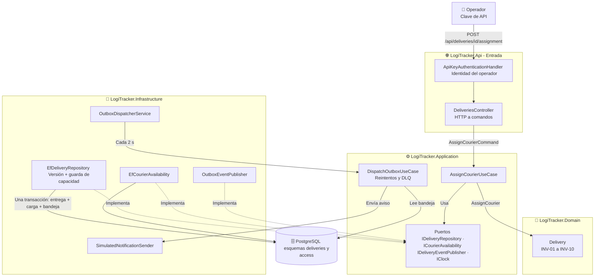

# Implementación del Vertical Slice: Asignar un Repartidor

Este documento muestra cómo el diseño de la [Actividad 3](../actividad-3/resumen-actividad-3.md) se convirtió en código ejecutable. Las decisiones tecnológicas y los ajustes al diseño están en el [ADR-003](../adr/ADR-003-implementacion-vertical-slice.md).

## 1. Qué se construyó

Un *vertical slice* recorre todas las capas para un flujo de negocio completo: **entrada HTTP → caso de uso → dominio → persistencia → integración**.



## 2. Estructura del repositorio

```text
/src
  LogiTracker.Domain/            Entidades, objetos de valor, invariantes y hechos (sin dependencias)
    Deliveries/                  Delivery, CourierAssignment, CourierAvailability, DeliveryWindow...
  LogiTracker.Application/       Casos de uso, contratos y puertos (solo depende del dominio)
    Deliveries/AssignCourier/    AssignCourierUseCase, AssignCourierCommand, AssignCourierResult
    Deliveries/Ports/            IDeliveryRepository, ICourierAvailability, IDeliveryEventPublisher
    Outbox/                      DispatchOutboxUseCase, OutboxPolicy, IOutboxStore
    Observability/               Métricas, trazas y mensajes de registro
  LogiTracker.Infrastructure/    Adaptadores (implementan los puertos)
    Persistence/                 DbContext, mapeos y migraciones de EF Core
    Deliveries/                  Repositorio, disponibilidad y publicador de la bandeja de salida
    Outbox/                      Almacén de la bandeja y despachador en segundo plano
  LogiTracker.Api/               Entrada HTTP, autenticación, errores y composición
/tests
  LogiTracker.Domain.Tests/          Invariantes, sin base de datos
  LogiTracker.Application.Tests/     Casos de uso con adaptadores en memoria
  LogiTracker.IntegrationTests/      API + PostgreSQL real (Testcontainers)
  LogiTracker.ArchitectureTests/     Fitness functions sobre las dependencias
/scripts/verify.ps1              Comprobación de calidad completa con evidencia
docker-compose.yml               PostgreSQL local reproducible
```

Las dependencias entre proyectos siguen la regla de la Actividad 3: `Api → Infrastructure → Application → Domain`. El compilador impide referencias en sentido contrario y las [pruebas de arquitectura](../../tests/LogiTracker.ArchitectureTests/ArchitectureRulesTests.cs) lo verifican.

## 3. Recorrido de una solicitud por las capas

| Paso | Capa | Qué ocurre | Archivo |
| :---: | :--- | :--- | :--- |
| 1 | Entrada | La cabecera `X-Api-Key` se valida contra el hash guardado y se obtiene el operador. | [ApiKeyAuthenticationHandler.cs](../../src/LogiTracker.Api/Security/ApiKeyAuthenticationHandler.cs) |
| 2 | Entrada | Se asigna un identificador de correlación que acompaña a todos los registros de la solicitud. | [CorrelationIdMiddleware.cs](../../src/LogiTracker.Api/Observability/CorrelationIdMiddleware.cs) |
| 3 | Entrada | El controlador valida el formato y construye `AssignCourierCommand` con el operador autenticado. | [DeliveriesController.cs](../../src/LogiTracker.Api/Controllers/DeliveriesController.cs) |
| 4 | Aplicación | El caso de uso carga la entrega y verifica que no tenga otro repartidor. | [AssignCourierUseCase.cs](../../src/LogiTracker.Application/Deliveries/AssignCourier/AssignCourierUseCase.cs) |
| 5 | Aplicación → Infra | Consulta la disponibilidad por el puerto, con un tiempo máximo de espera de 3 s. | [CourierAdapters.cs](../../src/LogiTracker.Infrastructure/Deliveries/CourierAdapters.cs) |
| 6 | Dominio | `Delivery.AssignCourier` aplica las invariantes y genera el hecho `CourierAssigned`. | [Delivery.cs](../../src/LogiTracker.Domain/Deliveries/Delivery.cs) |
| 7 | Infra | El hecho se agrega a la bandeja de salida (sin confirmar todavía). | [OutboxEventPublisher.cs](../../src/LogiTracker.Infrastructure/Deliveries/OutboxEventPublisher.cs) |
| 8 | Infra | Una transacción reserva el cupo del repartidor, guarda la entrega con control de versión y confirma la bandeja. | [EfDeliveryRepository.cs](../../src/LogiTracker.Infrastructure/Deliveries/EfDeliveryRepository.cs) |
| 9 | Entrada | El resultado se traduce a HTTP: 200, o un error con su código de negocio. | [ErrorResponses.cs](../../src/LogiTracker.Api/Errors/ErrorResponses.cs) |
| 10 | Infra (segundo plano) | El despachador toma el aviso pendiente y lo envía, con reintentos y DLQ. | [OutboxDispatcherService.cs](../../src/LogiTracker.Infrastructure/Outbox/OutboxDispatcherService.cs), [DispatchOutboxUseCase.cs](../../src/LogiTracker.Application/Outbox/DispatchOutboxUseCase.cs) |

## 4. Trazabilidad diseño → implementación

| Elemento de la Actividad 3 | Dónde está en el código | Comprobado por |
| :--- | :--- | :--- |
| Entidad `Delivery`, raíz del agregado (ADR-002 D-02) | `Domain/Deliveries/Delivery.cs` | `DeliveryAssignmentTests` |
| INV-01 un solo repartidor activo | `Delivery.GetAssignmentRejection` + versión en `DeliveryConfiguration` | `ESC_02_*`, `ESC_08_*` |
| INV-03 y INV-04 turno y capacidad | `Delivery.AssignCourier`, `CourierAvailability.IsAtCapacity` + guarda en `EfDeliveryRepository` | `ESC_04_*`, `ESC_05_*`, `INV_04_*` |
| INV-05 trazabilidad de la asignación | `CourierAssignment` (repartidor, operador, hora) | `ESC_01_*` |
| INV-07 motivo obligatorio | `ReleaseReason` | `ESC_11_*` |
| INV-08 ventana válida | `DeliveryWindow` | `ESC_12_*` |
| INV-10 reintento idempotente (ADR-002 D-05) | `Delivery.AssignCourier` + atajo en `AssignCourierUseCase` | `ESC_03_*` |
| Puertos `IDeliveryRepository`, `ICourierAvailability`, `IDeliveryEventPublisher`, `IClock` | `Application/Deliveries/Ports`, `Application/Common` | Adaptadores en memoria de `Application.Tests` |
| Control optimista (ADR-002 D-04) | Propiedad oculta `Version` | `ESC_08_concurrent_assignments_*` |
| Bandeja de salida (ADR-002 D-06) | `OutboxEventPublisher`, `EfOutboxStore`, `DispatchOutboxUseCase` | `Notification_outage_*`, `DispatchOutboxUseCaseTests` |
| Catálogo de errores (ADR-002 D-08) | `DeliveryErrors`, `ApplicationErrors`, `ErrorResponses` | `AssertBusinessErrorAsync` en cada prueba de integración |
| Carpetas por capa con subcarpeta por módulo (ADR-002 D-07) | `src/*/Deliveries` | `ArchitectureRulesTests` |

## 5. Puntos de entrada

| Método | Ruta | Propósito | Respuestas |
| :--- | :--- | :--- | :--- |
| `POST` | `/api/deliveries` | Registrar una entrega a partir de un pedido listo para logística (C-01). Idempotente por pedido. | 201 · 200 (ya existía) · 400 |
| `GET` | `/api/deliveries/{id}` | Estado, repartidor activo e historial. | 200 · 404 |
| `POST` | `/api/deliveries/{id}/assignment` | **Asignar repartidor.** | 200 · 404 · 409 · 422 · 503 |
| `POST` | `/api/deliveries/{id}/assignment/release` | Liberar al repartidor con motivo. | 200 · 400 · 404 · 409 |
| `GET` | `/api/couriers` | Repartidores con turno y carga. | 200 |
| `GET` | `/api/outbox/dead-letters` | Avisos apartados (DLQ). | 200 |
| `POST` | `/api/outbox/dead-letters/{id}/requeue` | Reprocesar un aviso tras corregir la causa. | 202 · 404 |
| `GET` | `/health` | Salud de la API y de la base de datos (sin autenticación). | 200 · 503 |
| `PUT` | `/api/dev/faults` | **Solo desarrollo:** provocar fallas controladas. | 200 |

Todas las rutas `/api` exigen la cabecera `X-Api-Key`. Los errores siguen el formato estándar *ProblemDetails* e incluyen `code` (catálogo de negocio) y `correlationId`.

## 6. Patrones de los videos: cuáles se aplicaron y por qué

El enunciado pide no implementar todos los patrones, sino **justificar cuáles aplican**.

| Video | Patrón | ¿Se aplicó? | Justificación |
| :--- | :--- | :---: | :--- |
| 3 | Monorepo con Pantsbuild | Parcial | El repositorio ya es un monorepo: código, pruebas, infraestructura (`docker-compose.yml`) y documentación juntos. Pantsbuild **no** aplica: hay una sola solución .NET y `dotnet` ya resuelve las dependencias entre proyectos. |
| 4 | Trunk Based Development | Parcial | Commits pequeños sobre `main`, revisados antes de subir. Sin *rulesets* ni CI: se decidió no usar GitHub Actions y las comprobaciones se ejecutan con `scripts/verify.ps1`. |
| 14 | Strangler Fig | No | No hay un sistema antiguo dentro del código. Es la estrategia prevista para **introducir LogiTracker junto a la operación actual** (restricción RES-01): empezar por la asignación y desviar el resto por partes. |
| 15 | Migraciones (Flyway) | **Sí**, con EF Core | Versionadas, aplicadas en orden, con tabla de historial, y probadas desde una base vacía (ADR-003 T-03). |
| 16 | API Gateway | No | Hay una sola API (ADR-001). Una puerta adicional agregaría una pieza sin resolver un problema actual. |
| 18 | Infraestructura como código | **Sí** (mínima) | `docker-compose.yml` describe la base de datos; las credenciales son solo de desarrollo. |
| 19 | Mensajes vs. eventos | **Sí** | `CourierAssigned` y `CourierReleased` son **eventos**: hechos ya ocurridos que se publican después de confirmarse. |
| 20 | Productor-consumidor | **Sí** | El caso de uso produce avisos en la bandeja de salida; el despachador los consume. Varias instancias pueden consumir en paralelo con `SKIP LOCKED`. |
| 21 | Dead Letter Queue | **Sí** | Reintentos limitados con espera creciente; los fallos permanentes o agotados se apartan y pueden reprocesarse tras corregir la causa. |
| 22 | Comparing Consumers | No | No hay dos versiones de un consumidor que comparar. |
| 23 | Process Manager | No | El flujo tiene un solo paso de negocio; no hay una secuencia larga que coordinar. |
| 24 | Durable State vs. Event Sourcing | **Durable State** | Se guarda el estado actual más el **historial de asignaciones**, suficiente para la trazabilidad (EC-10). Event Sourcing agregaría complejidad sin una necesidad de auditoría que lo exija. |
| 25 | Máquinas de estado en el front-end | No | No hay interfaz gráfica; los estados de la entrega se controlan en el dominio. |

## 7. Cómo ejecutarlo

Las instrucciones completas están en el [README](../../README.md#cómo-ejecutar-la-actividad-4). En resumen:

```powershell
docker compose up -d                                  # PostgreSQL local
dotnet run --project src/LogiTracker.Api              # API en http://localhost:5125 (migra y carga datos de demo)
powershell -ExecutionPolicy Bypass -File scripts/verify.ps1   # Todas las comprobaciones con evidencia
```

La demostración paso a paso, incluidas las fallas controladas, está en [LogiTracker.Api.http](../../src/LogiTracker.Api/LogiTracker.Api.http).
