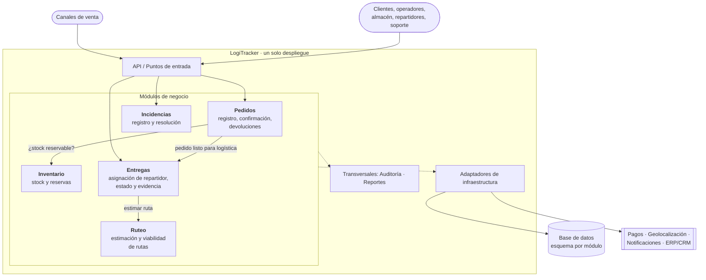

# ADR-001: Monolito modular por dominios como estructura inicial

| Campo | Valor |
| :--- | :--- |
| **Estado** | Aceptada |
| **Fecha** | 2026-10-11 |
| **Actividad** | Actividad 2: Requisitos y decisión estructural |
| **Requisitos relacionados** | RNF-01 Consistencia, RNF-03 Facilidad de evolución, RNF-06 Escalabilidad, RES-01 a RES-05 |

## Contexto

LogiTracker debe centralizar el ciclo de vida del pedido: registro, validación de stock, asignación de ruta y repartidor, seguimiento e incidencias. Hoy cada área usa herramientas distintas y no existe una única fuente de verdad ([análisis del problema](../actividad-1/analisis-problema.md)).

Las fuerzas que condicionan la decisión son:

- **Consistencia es el atributo prioritario** ([matriz de priorización](../actividad-2/matriz-priorizacion.md)): no puede haber sobreventas, pedidos duplicados ni asignaciones dobles (riesgos R1 y R2).
- **El sistema debe evolucionar sin caos** (RES-04): un cambio en las reglas de rutas no puede romper pedidos o inventario.
- **El crecimiento es acelerado pero no uniforme** (RES-02): algunas áreas, como Ruteo en temporada alta, pueden necesitar escalar más que otras.
- **La empresa prioriza confiabilidad y tiempo de entrega sobre una arquitectura "perfecta"** (RES-05).
- **Supuestos de contexto:** un único equipo pequeño (SC-01) y sin automatización madura de despliegue ni monitoreo distribuido (SC-02).

## Decisión

**Construir LogiTracker como un monolito modular**: una sola aplicación desplegable, dividida internamente en módulos que corresponden a áreas del negocio, con límites y contratos explícitos.

### Reglas que hacen cumplir la decisión

1. **Un módulo por área de negocio**: Pedidos, Inventario, Ruteo, Entregas e Incidencias. Cada uno es dueño de sus datos y de sus reglas.
2. **Comunicación solo por contratos**: un módulo nunca lee ni escribe las tablas de otro ni usa sus clases internas; usa la interfaz pública o los eventos que el otro módulo expone.
3. **El negocio no depende de la infraestructura**: las reglas de cada módulo dependen de interfaces (puertos); la base de datos y los servicios externos se implementan como adaptadores.
4. **Esquema de datos separado por módulo** dentro de una misma base de datos, para que una extracción futura no requiera desenredar tablas compartidas.
5. **Ruteo detrás de un contrato estable** (por ejemplo, un estimador de rutas), porque es el primer candidato a extraerse como servicio si la evidencia lo justifica.
6. **La tecnología concreta** (lenguaje, framework, motor de base de datos) se decide en ADRs posteriores; esta decisión es solo estructural.

## Alternativas consideradas

La comparación completa está en [comparacion-alternativas.md](../actividad-2/comparacion-alternativas.md).

| Alternativa | Puntaje | Motivo de descarte |
| :--- | :---: | :--- |
| A · Monolito por capas tradicional | 3,45 | Rápido y barato, pero mezcla las reglas de todas las áreas. Repetiría el problema actual (falta de límites) y no cumple los escenarios de evolución EC-07 y EC-08. |
| **B · Monolito modular por dominios** | **4,25** | **Elegida.** |
| C · Microservicios por dominio | 2,45 | Escala por servicio, pero complica la consistencia (atributo prioritario), multiplica el costo operativo y no hay evidencia de que un área necesite desplegarse por separado. |

## Justificación

- **Protege la consistencia**: las operaciones críticas (reservar stock y confirmar pedido, asignar repartidor) ocurren dentro del mismo proceso, con transacciones locales. Así se cumplen EC-03 y EC-04 sin coordinación distribuida.
- **Permite evolucionar**: los cambios de reglas quedan en el módulo responsable (EC-07), y los de proveedores en su adaptador (EC-08).
- **Es proporcional al problema**: un despliegue, una base de datos y un equipo. Cumple RES-05 y es coherente con SC-01 y SC-02.
- **No cierra la puerta al crecimiento**: los límites por módulo y el esquema separado permiten extraer un módulo como servicio cuando haya evidencia, sin reescribir el sistema (RES-01, RES-02).

## Consecuencias y trade-offs

### Lo que ganamos
- Consistencia fuerte en las operaciones críticas.
- Un solo despliegue: menor costo, menos fallas de red y diagnóstico más sencillo.
- Límites de negocio claros, que se pueden explicar y probar.
- Ruta de evolución gradual hacia servicios independientes si se necesita.

### Lo que aceptamos (costos)
- **La aplicación escala completa**, no por módulo: en un pico, se agregan instancias de todo el sistema aunque solo Ruteo esté saturado.
- **Una falla grave en un módulo puede afectar a toda la aplicación**, porque comparten proceso.
- **Los límites dependen de la disciplina del equipo**: nada físico impide que un módulo acceda a otro saltándose el contrato. Hay que vigilarlo con revisiones y pruebas de arquitectura.
- **Trabajo adicional en contratos** entre módulos, comparado con la alternativa A.

## Riesgos y mitigaciones

| Riesgo | Mitigación |
| :--- | :--- |
| Los módulos se acoplan con el tiempo y el sistema degenera en la alternativa A. | Pruebas automáticas de dependencias entre módulos y revisión de código enfocada en los límites ([CV-04, CV-05](../actividad-2/criterios-verificables.md)). |
| Ruteo satura la aplicación en temporada alta (R4). | Contrato estable para Ruteo; caché de estimaciones y cola de solicitudes como primera medida; extracción a servicio si se cumplen las señales de revisión. |
| Un servicio externo lento bloquea la aplicación completa. | Adaptadores con tiempo máximo de espera, reintentos y estados intermedios como "pendiente de pago" (EC-05). |
| Los supuestos SC-01, SC-02 o SM-01 a SM-06 resultan falsos. | Revisar esta decisión según los criterios verificables. |

## Criterios de revisión

Esta decisión se revisa si ocurre cualquiera de las situaciones descritas en [criterios-verificables.md](../actividad-2/criterios-verificables.md#3-señales-que-obligan-a-revisar-la-decisión), en particular:

- Ruteo incumple su objetivo de rendimiento y bloquea la confirmación de pedidos durante **dos campañas consecutivas**.
- Aparecen equipos independientes que necesitan desplegar un módulo con una frecuencia distinta a la del resto.
- Los supuestos de volumen (SM-01, SM-02) se superan de forma sostenida.
